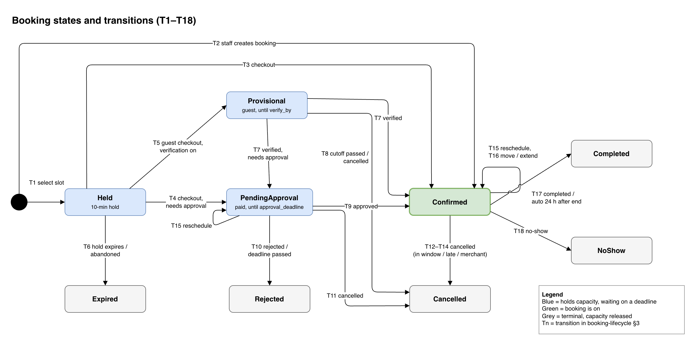

# Booking Lifecycle

> Status: v1.2 — no open questions. v1.2 (2026-11-19): state diagram redrawn in draw.io with transition numbers. v1.1 (2026-11-18): staff booking rules (D84), verify_by cap for approval services (D85), reschedule resource preference (D83); transaction design in [deep-dive 01](../06-deep-dives/01-booking-core/01-booking-core.md). Entities are defined in the [domain model](domain-model.md); money effects are detailed in the [ledger model](ledger-model.md). Decisions Dxx live in [Product Vision §9](../01-product/vision-and-purpose.md#9-decisions-log).

## 1. States

| State | Meaning | Holds capacity | Terminal |
|---|---|---|---|
| Held | Slot selected, checkout not done; expires 10 min after creation (D23, D48) | Yes, until hold_expires_at | No |
| Provisional | Guest booking awaiting verification until verify_by (FR-702) | Yes | No |
| PendingApproval | Awaiting merchant decision until approval_deadline; payment taken (D11) | Yes | No |
| Confirmed | Booking is on | Yes | No |
| Completed | Service delivered (manual or auto, D32) | No | Yes |
| NoShow | Customer didn't attend | No | Yes |
| Cancelled | Cancelled by customer, guest, merchant, or auto at verification cutoff | No | Yes |
| Rejected | Rejected by merchant or auto-rejected at deadline | No | Yes |
| Expired | Hold ran out or was abandoned before checkout (D49) | No | Yes |

## 2. State diagram

*Source: [diagrams/booking-states.drawio](diagrams/booking-states.drawio). Arrow labels are the transition numbers in §3; the transaction for each is in [deep-dive 01 §6](../06-deep-dives/01-booking-core/01-booking-core.md#6-transactions).*

## 3. Transitions

Money column refers to the operations in [ledger model §4](ledger-model.md#4-money-flows-per-booking-operation). Every transition appends a BookingEvent (NFR-901) and applies state + allocations + money atomically (NFR-103, NFR-104).

| # | From → To | Trigger / actor | Guards | Effects | Money | Ref |
|---|---|---|---|---|---|---|
| T1 | ∅ → Held | Customer/Guest selects slot | Merchant live; within min_notice/max_horizon; all required resources free; guest rules (T1a); approval services: start − approval_margin > now | Allocations created with expires_at = now + 10 min | — | FR-502, D59 |
| T1a | (guard) | Guest | Guest bookings allowed; service has no payment terms; if verification on, start − late_booking_cutoff > now | — | — | FR-701, D38 |
| T2 | ∅ → Confirmed | Owner/Staff creates booking | Resources free; within bookable hours unless staff override (logged); max_horizon (no min_notice); registered customer or walk-in contact (name + email/phone) | Allocations created without expiry; terms with zero payments | — | FR-602, D21, D53, D84 |
| T3 | Held → Confirmed | Checkout, registered Customer or guest with verification off; no approval | Hold not expired; available balance covers upfront + reservations | Allocation expiry cleared | M1 Checkout | FR-504, FR-505 |
| T4 | Held → PendingApproval | Checkout; service requires approval | As T3; computed approval_deadline > now | approval_deadline = min(now + window, start − margin); notify Owner + assigned Staff | M1 Checkout | FR-506, D59 |
| T5 | Held → Provisional | Guest checkout, verification on | Hold not expired | verify_by set (§4); send email link + SMS code | — | FR-702, FR-705 |
| T6 | Held → Expired | System at hold_expires_at, or customer abandons | — | Allocations released | — | FR-502, D49 |
| T7 | Provisional → Confirmed / PendingApproval | Guest verifies, or Owner/Staff verifies | now < verify_by; valid token/code | PendingApproval if service needs approval (deadline as T4) | — | FR-703, FR-707 |
| T8 | Provisional → Cancelled | System at verify_by; guest via link; Owner/Staff | — | Allocations released | — | FR-704, FR-706 |
| T9 | PendingApproval → Confirmed | Owner or assigned Staff approves | now < approval_deadline | — | — | FR-603, D33 |
| T10 | PendingApproval → Rejected | Owner/assigned Staff rejects; System at approval_deadline | — | Allocations released | M2 Full refund | FR-603, FR-801 |
| T11 | PendingApproval → Cancelled | Customer/Guest cancels; Owner/Staff cancels | before start | Allocations released | M2 Full refund | FR-509, FR-604, D60 |
| T12 | Confirmed → Cancelled (in window) | Customer/Guest, now ≤ start − free window | — | Allocations released | M2 Full refund | FR-509, FR-706 |
| T13 | Confirmed → Cancelled (late) | Customer/Guest, after free window, before start | — | Allocations released | M3 Late cancel | FR-509 |
| T14 | Confirmed → Cancelled (merchant) | Owner/Staff | before end | Allocations released | M2 Full refund | FR-604 |
| T15 | Confirmed / PendingApproval → same state (reschedule) | Customer, same service + merchant | now ≤ start − free window; new slot free; for PendingApproval also new start − approval_margin > now | §5 (customer may ask to keep the current resource, D83); PendingApproval gets a new approval_deadline | — (carries over) | FR-510, FR-511, D50, D61 |
| T16 | Confirmed → Confirmed (move / extend) | Owner/Staff | New range free on all resources | Allocations replaced atomically | — | FR-606 |
| T17 | Confirmed → Completed | Owner/Staff after start; System at end + 24h | — | Allocations released | M4 Complete | FR-605, FR-608 |
| T18 | Confirmed → NoShow | Owner/Staff after start | Before auto-complete | Allocations released | M5 No-show | FR-605, D58 |

## 4. Time rules

| Deadline | Value | Ref |
|---|---|---|
| hold_expires_at | Held created_at + 10 min (also for a reschedule's tentative set) | D23, D50 |
| verify_by | start − verification_cutoff; if that is ≤ now at checkout (late guest booking): start − late_booking_cutoff. For approval services capped at start − approval_margin | FR-704, FR-705, D31, D85 |
| approval_deadline | min(requested_at + approval_window, start − approval_margin) | D59 |
| free-cancellation end | start − free_cancellation_window (from the terms snapshot) | FR-509 |
| auto-complete | end + 24h | D32 |

- **Effective state (NFR-107):** every read and write evaluates deadlines against server time. A Held booking past hold_expires_at is Expired, a Provisional past verify_by is Cancelled, a PendingApproval past approval_deadline is Rejected — even before the scheduled job has written it. Their allocations stop counting immediately (allocation `expires_at`, or the transition check in the same transaction).
- The scheduled job then **materialises** the transition and its money movements, exactly once in effect (NFR-108), using the same compare-and-set as user actions.
- Late guest bookings are told the verify_by time immediately (FR-705).

## 5. Reschedule (D50)

1. Customer picks a new slot → a **tentative** allocation set is created on the same booking, expires_at = now + 10 min. The current set stays active.
2. Customer confirms → in one transaction: tentative becomes current, old current is released, start/end updated, BookingEvent `rescheduled`. Terms, payments and reservations are unchanged.
3. If not confirmed in time, the tentative set expires; the booking keeps its original slot.

A booking has at most one tentative set at a time. Rescheduling a PendingApproval booking keeps it pending and recomputes approval_deadline = min(now + window, new start − margin); the merchant is notified to decide on the new slot (D61). Provisional bookings can't be rescheduled (guests cancel and rebook, D34). Completed and NoShow are terminal — no correction in the MVP (D62).

## 6. Concurrency rules

- All transitions on a booking are compare-and-set on its `version`; the first committed one wins, the other gets a conflict error with the current state (NFR-109). Examples: customer cancels vs staff marks no-show; approval vs deadline job.
- Allocation creation checks overlap against effective allocations on each resource in the same transaction (NFR-101). For "any of" requirements the system picks a free candidate; a concurrent loss retries with another candidate before failing.
- All commands carry an idempotency key (NFR-106); a retried checkout returns the original outcome.

## 7. Open questions

| # | Question | Status | Raised |
|---|---|---|---|
| Q1 | Refund when cancelling a PendingApproval booking | Resolved → D60 | 2026-11-12 |
| Q2 | Rescheduling Provisional / PendingApproval bookings | Resolved → D61 | 2026-11-12 |
| Q3 | Correcting Completed ↔ NoShow | Resolved → D62 | 2026-11-12 |

## 8. Change log

| Version | Date | Change |
|---|---|---|
| v0.9 | 2026-11-12 | First draft (D48–D50, D57–D59) |
| v1.0 | 2026-11-12 | Open questions resolved (D60–D62) |
| v1.1 | 2026-11-18 | D83–D85 from deep-dive 01 (staff rules, verify_by cap, reschedule resource preference) |
| v1.2 | 2026-11-19 | State diagram in draw.io (`diagrams/booking-states`), labelled with T1–T18; Mermaid version removed |
