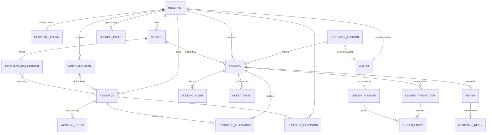

# Domain Model

> Status: v1.2 — no open questions. v1.2 (2026-11-16): credentials and MFA held by the identity provider (D80). v1.1 (2026-11-15): staff link moved to Resource (D78), reminder offsets in terms (D79), PushDevice (D76). Built from [Functional Requirements](../02-requirements/functional-requirements.md) v1.1, [Non-Functional Requirements](../02-requirements/non-functional-requirements.md) v1.0 and the decisions log in [Product Vision §9](../01-product/vision-and-purpose.md#9-decisions-log) (D48–D63 added for this phase).
> Companion docs: [Booking lifecycle](booking-lifecycle.md) · [Ledger model](ledger-model.md) · [Glossary](glossary.md).

## 1. Conventions

- **Ids** are opaque, globally unique (e.g. UUIDv7). No business meaning in ids.
- **Tenant key:** every merchant-owned entity carries `merchant_id`. Tenant isolation (NFR-601) is enforced on this key.
- **Time:** instants are stored in UTC; local wall-clock values (opening hours, slot starts) are stored with the merchant's IANA `time_zone` (NFR-1001). Durations are minutes.
- **Money:** integer minor units of the single virtual currency; each wallet carries a currency code for the future. Percentages are converted to amounts at booking time and stored in the booking's terms snapshot.
- **Versioning:** configuration that a booking depends on (service, policy) is immutable per version; editing creates a new version (FR-311, NFR-605, NFR-903).
- **Optimistic concurrency:** aggregates carry a `version`; conflicting writes fail with a conflict error (NFR-109).

## 2. Modules (candidate bounded contexts)

| Module | Owns | Consistency |
|---|---|---|
| Identity & access | CustomerAccount, MerchantUser | Strong |
| Merchant catalog | Merchant, MerchantPolicy, Resource, Service, ResourceRequirement | Strong (versioned) |
| Schedules | OpeningHours, WorkingHours, ScheduleException | Strong |
| Booking | Booking, ResourceAllocation, BookingEvent, GuestToken | Strong, linearizable per resource (NFR-102) |
| Wallet & ledger | Wallet, LedgerAccount, LedgerTransaction, LedgerEntry | Strong, linearizable per wallet (NFR-102) |
| Notifications | Notification, NotificationPreference | Eventual |
| Reviews | Review, MerchantReply | Strong writes; rating is a read model |
| Discovery (read models) | Availability/slots, search index, merchant rating, calendars, client history | Eventual (NFR-501, NFR-504) |

These are logical boundaries for the domain; whether they become separate services is decided in [05-architecture](../05-architecture/).

## 3. Entity-relationship overview

## 4. Identity & access

Two separate identity types (D51); the same email may exist in both. Since D80 both live in Keycloak (one realm per type): credentials (password hash), MFA and sessions are held by the identity provider; the tables below are the logical model.

### CustomerAccount (global)

| Attribute | Notes |
|---|---|
| id, email (unique), password_hash, mfa (optional) | FR-1301, NFR-701, NFR-702 |
| name, phone | Profile |
| status | `active` · `deleted` (personal data erased/pseudonymised, NFR-804) |
| notification preferences | Reminder opt-out (FR-1005) |

- Has exactly one customer Wallet (FR-901).
- Not tenant-scoped; a merchant sees it only through its own bookings (NFR-602).

### MerchantUser

| Attribute | Notes |
|---|---|
| id, merchant_id, email (unique across all merchants), password_hash | Belongs to exactly one merchant (D51, D63) |
| role | `owner` · `staff` (D28) |
| status | `invited` · `active` · `deactivated` (FR-202) |
| mfa | Required for `owner` (NFR-701) |

- Invariant: exactly one active `owner` per merchant (FR-201).
- A Staff user is linked to one staff Resource; the link is stored on the Resource (`linked_user_id`, D78).
- "Assigned staff" of a booking = the MerchantUser linked to a staff Resource allocated to it (D33).

### Guests and walk-ins

Not identities. Their details are a **contact** value embedded on the booking (D52): `name`, `email?`, `phone?`, plus normalised email/phone keys used for merchant client history (D53).

- Guest: name, email and phone all required (FR-701).
- Walk-in/phone client: name + at least one of email/phone (FR-602, D53).

## 5. Merchant catalog & schedules

### Merchant (tenant)

| Attribute | Notes |
|---|---|
| id, name, category | Category from the fixed list (D17) |
| address, geo point, country, time_zone (IANA) | FR-101, NFR-1001 |
| contact, profile (description, photos), branding (logo, colours) | FR-103 |
| status | `setup` → `live` ⇄ `paused` (FR-102, FR-104) |
| booking_page_slug | Booking page URL / widget key (FR-105) |

- `setup` → `live` requires ≥1 active service, ≥1 active resource and opening hours (FR-102).
- `paused` hides the merchant from marketplace and booking page; existing bookings unaffected (FR-104).

### MerchantPolicy (versioned, one current per merchant)

| Attribute | Ref |
|---|---|
| guest_bookings_allowed, guest_verification_enabled | FR-308 |
| verification_cutoff, late_booking_cutoff (late < verification) | FR-308, D31 |
| free_cancellation_window, late_cancellation_kept_percent | FR-309 |
| min_notice, max_horizon | FR-310 |
| reminder_offsets[] | FR-312 |

### Resource

| Attribute | Notes |
|---|---|
| id, merchant_id, type | `staff` · `table` · `room` · `bay` · `equipment` (FR-301) |
| name, seating_capacity (tables only), active | |
| linked_user_id | Staff resources only: the MerchantUser (Owner or Staff) of the same merchant working as this resource; at most one resource per user (FR-202, D78) |

Types are data, not code: a new vertical is configuration (NFR-1304).

### Service (versioned)

| Attribute | Ref |
|---|---|
| id, merchant_id, name, description, price | FR-302 |
| duration, buffer_before, buffer_after | FR-302 |
| multi_day (duration counted in opening hours only) | FR-304, D30 |
| party_size_based (table services) | FR-305 |
| upfront: none · deposit · prepayment, as fixed or % | FR-306, D56 |
| no_show_fee: none · fixed · % | FR-306 |
| remainder_settlement: at_venue · via_wallet | FR-313, D57 |
| requires_approval, approval_window, approval_margin | FR-307, D59 |
| active | |

- **Payment terms** = upfront ≠ none, or no_show_fee ≠ none, or remainder_settlement = via_wallet. A service with payment terms can only be booked online by a registered Customer (FR-701).
- Prepayment = full price, so the remainder is 0.

### ResourceRequirement

One per resource the service needs at the same time (FR-303, D19).

| Attribute | Notes |
|---|---|
| service_id, resource_type | |
| selector | `specific` (one resource) · `any_of` (set of resources) |
| customer_choosable | Customer may pick a specific staff member or "any available" (FR-404) |
| fits_party_size | Table requirements: chosen table must have seating_capacity ≥ party_size (FR-305) |

### Schedules

| Entity | Meaning |
|---|---|
| OpeningHours | Merchant weekly hours per weekday in local time (FR-401) |
| WorkingHours | Resource weekly hours; default = opening hours (FR-401) |
| ScheduleException | Merchant- or resource-level, local date/time range: `closed` (closure, holiday, time-off) or `extra_hours` (FR-402, FR-205) |

Bookable time for a resource = opening hours ∩ working hours, adjusted by exceptions. Slots are **not stored**: they are computed (FR-403) and cached as an eventually-consistent read model (NFR-501).

## 6. Booking

Full state machine and transition rules: [booking-lifecycle.md](booking-lifecycle.md).

### Booking (aggregate root)

| Attribute | Notes |
|---|---|
| id, merchant_id, service_id (+ service version) | One service per booking (D19) |
| origin | `marketplace` · `booking_page` · `widget` · `merchant` |
| customer_id? | Set for registered customers (D52) |
| contact? | Guest or walk-in contact (§4) |
| created_by | customer · guest · merchant_user(id) |
| party_size? | Table services |
| start, end | UTC instants + merchant time_zone; end computed across opening hours for multi-day (FR-304) |
| state | Held · Provisional · PendingApproval · Confirmed · Completed · NoShow · Cancelled · Rejected · Expired |
| hold_expires_at | Held only: created_at + 10 min (D23) |
| verify_by | Provisional only: start − verification or late-booking cutoff (FR-704, FR-705) |
| approval_deadline | PendingApproval only (D59) |
| terms | Snapshot of the terms the booking was made under (below) |
| version | Optimistic concurrency |

Invariants:

- Exactly one of `customer_id` / `contact` is set; `contact` only for guest or merchant-created bookings.
- Merchant-created bookings have zero payment terms in their snapshot and settle at venue (D21, D57).
- Every state change appends a BookingEvent (FR-507, NFR-901).

### BookingTerms (value object, immutable snapshot)

price; upfront kind and amount; no_show_fee amount; remainder_settlement and remainder amount; free_cancellation_window and kept_percent; requires_approval; cutoffs applied; reminder offsets (D79); service and policy version ids. Changing a service or policy never changes an existing booking (FR-311).

### ResourceAllocation

The unit on which **no double-booking** (NFR-101) is enforced.

| Attribute | Notes |
|---|---|
| booking_id, merchant_id, resource_id | One per required resource … |
| range | … per contiguous segment: `[start − buffer_before, end + buffer_after)`; multi-day bookings have one segment per open period spanned (D30) |
| set | `current` · `tentative` (reschedule in progress, D50) |
| expires_at? | For Held bookings and tentative sets: the hold expiry |
| active | False once released |

Invariant: for any resource, no two **effective** allocations overlap, where effective = active and (no `expires_at` or `expires_at` > now). Expired holds therefore free capacity the instant they pass, before any cleanup (NFR-107).

### BookingEvent (append-only)

booking_id, from_state, to_state (or `rescheduled` / `moved` / `extended` for same-state changes), at (UTC), actor (customer · guest · merchant_user · system+job), reason, related ledger transaction id.

### GuestToken

booking_id, purpose (`verify` · `cancel`), channel (email link · SMS code), token/code hash, expires_at, attempts, used_at. Single-purpose, ≥128-bit, rate-limited (NFR-704).

## 7. Wallets, reviews, notifications

- **Wallets & ledger:** see [ledger-model.md](ledger-model.md).
- **Review:** id, booking_id (unique — one per Completed booking), merchant_id, customer_id, stars 1–5, text?, created_at (FR-1201). **MerchantReply:** one per review, by the Owner (FR-1202). **Merchant rating** = average + count, a read model (FR-1203).
- **Notification:** recipient, template, channel (email · push · in-app · SMS for guest verification only), dedup key (event id + recipient + template), status, attempts (NFR-1101, D22). **NotificationPreference:** per CustomerAccount / MerchantUser; only non-essential types (reminders) can be turned off (FR-1005). **PushDevice:** owner (CustomerAccount / MerchantUser), platform, device token, last_seen; registered by the apps (D76). No in-app notification inbox in the MVP (D76).
- **Client history (read model):** per merchant, bookings grouped by `customer_id`, or for guests/walk-ins by normalised email or phone (D53). A registered customer's history does not include guest bookings made with the same email (D36).

## 8. Open questions

| # | Question | Status | Raised |
|---|---|---|---|
| Q1 | MerchantUser email uniqueness | Resolved → D63 | 2026-11-12 |

## 9. Change log

| Version | Date | Change |
|---|---|---|
| v0.9 | 2026-11-12 | First draft (D48–D59) |
| v1.0 | 2026-11-12 | Open question resolved (D63) |
| v1.1 | 2026-11-15 | Staff link on Resource (D78); reminder offsets in BookingTerms (D79); PushDevice (D76) |
| v1.2 | 2026-11-16 | Credentials, MFA and sessions held by Keycloak (D80) |
