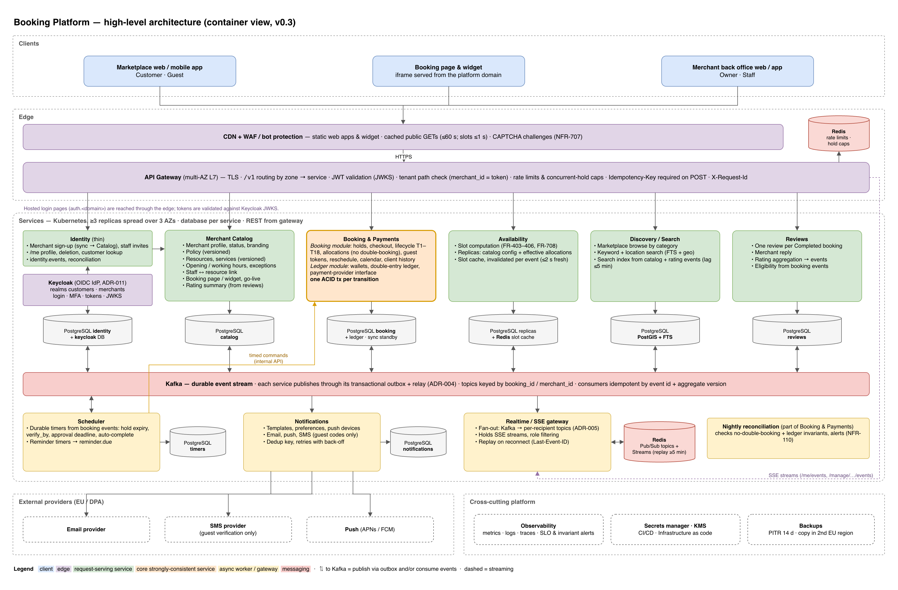
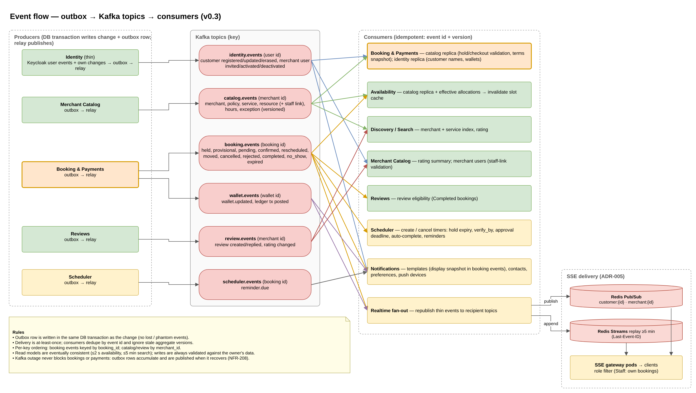
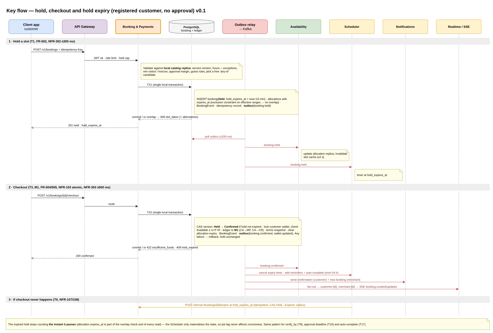
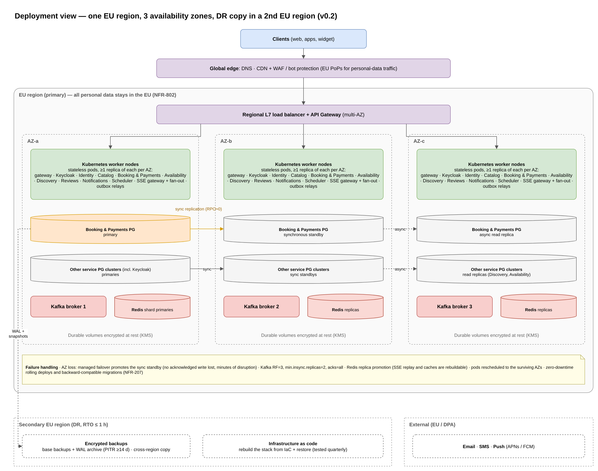

# High-Level Architecture

> Status: v0.4 — first pass (D70–D75), requirements check (D76–D79, §10.2), Keycloak as identity provider (D80), booking core refined in deep-dive 01 (D81–D89, Q4 resolved), deliberately simple. Scalability, performance and internals are refined in the deep-dives — see the [deep-dives backlog](../06-deep-dives/README.md).
> Inputs: [Functional](../02-requirements/functional-requirements.md) v1.1 and [non-functional requirements](../02-requirements/non-functional-requirements.md) v1.0, [domain model](../03-domain/domain-model.md), [booking lifecycle](../03-domain/booking-lifecycle.md), [ledger model](../03-domain/ledger-model.md), [API conventions](../04-api-design/api-conventions.md), [endpoint catalogue](../04-api-design/endpoint-catalogue.md). Decisions Dxx live in [Product Vision §9](../01-product/vision-and-purpose.md#9-decisions-log).
> Diagrams are drawn in draw.io: the `.drawio` sources sit next to the exported `.png` files in [`diagrams/`](diagrams/). Edit the source, then re-export the PNG with the same name.

## 1. Architectural drivers

The requirements that shape the architecture most:

| Driver | Requirement | Architectural answer |
|---|---|---|
| No double-booking, atomic money | NFR-101–105, FR-503/504 | Booking and Ledger live in **one service and one database**; each lifecycle transition is a single local ACID transaction (§3, ADR-006) |
| Correct timed transitions regardless of lag | NFR-107/108 | **Effective state** evaluated on every read/write; a Scheduler only materialises transitions, idempotently (§6.3, ADR-010) |
| Booking path 99.9%, independent of the rest | NFR-201/202, NFR-208 | Booking path depends only on gateway → Booking & Payments → its DB. Catalog data is a **local replica** (ADR-009); events leave through an outbox, so Kafka, notifications or search can fail without blocking bookings |
| Availability ≤2 s fresh, slot query ≤300 ms at ~10k/s | NFR-301, NFR-402, NFR-501 | Separate **Availability** read service with event-driven cache invalidation; authoritative check stays in Booking (NFR-502) |
| Live calendars ≤2 s | NFR-503 | SSE gateway with per-recipient Redis topics (ADR-005, ADR-008) |
| Strict tenant isolation | NFR-601–604 | Tenant checked at the gateway **and** in every service's data-access layer (§7.1) |
| RPO≈0, RTO≤1 h, one EU region, 3 AZs | NFR-203–206, NFR-802 | Synchronous standby in a second AZ, Kafka RF=3, encrypted backups copied to a 2nd EU region (§8) |
| Real payment provider later | FR-907, NFR-1302 | Ledger module talks to funding only through a payment-provider interface |

## 2. Overview

*Source: [diagrams/01-container-view.drawio](diagrams/01-container-view.drawio)*

**Style (D70):** microservices behind one API gateway, each owning its own PostgreSQL database. Services communicate mainly through **events** (outbox → Kafka); synchronous service-to-service calls are kept to a minimum (§5.3). Boundaries follow the domain modules ([domain model §2](../03-domain/domain-model.md#2-modules-candidate-bounded-contexts)), with one deliberate merge: **Booking + Wallet & ledger = Booking & Payments**, because their state must change together.

**Layers:**

1. **Clients** — marketplace web/app, booking page and widget (iframe on the platform domain), merchant back office. All use the same public `/v1` API (NFR-1301).
2. **Edge** — CDN + WAF / bot protection (static apps, cached public GETs, CAPTCHA challenges) and the **API gateway** (TLS, routing by URL zone, JWT validation, tenant path check, rate limits and hold caps, Idempotency-Key presence, request ids).
3. **Services** — request-serving services (green/orange) and async workers (yellow).
4. **Data & messaging** — PostgreSQL per service, Redis (rate limits, slot cache, SSE pub/sub and replay), Kafka (durable event stream).
5. **External** — email, SMS, push providers; platform services (observability, secrets/KMS, CI/CD + IaC, backups).

## 3. Services

| Service | Responsibilities | Owns (data) | Serves (API zone) | Publishes | Consumes |
|---|---|---|---|---|---|
| **Identity** (thin) + **Keycloak** | *Keycloak (IdP, D80):* customer self-registration, login, MFA (required for Owners), password policy + brute-force protection, sessions, JWT issuing with JWKS, refresh-token rotation, re-auth (`max_age`). *Identity service:* merchant sign-up orchestration, staff invitations/deactivation, `/me` profile and account deletion, exact-match customer lookup (D77), publishing `identity.events`, reconciliation with Keycloak | Keycloak: users, credentials, MFA, sessions (realms `customers`, `merchants`). Identity: invitations, outbox | Keycloak OIDC endpoints; `/auth/merchant-signups`, `/auth/invitations/*`, `/me` (profile), `/manage/…/users*`, `/manage/…/customers/lookup` | `identity.events` | Keycloak user events (event-listener extension) |
| **Merchant Catalog** | Merchant profile, status (setup/live/paused), go-live check, branding, booking page/widget, policy (versioned), resources, services (versioned) with requirements and payment terms, opening/working hours, exceptions, staff ↔ resource link (D78); rating summary on the public profile | Merchant, MerchantPolicy, Resource (incl. `linked_user_id`), Service, ResourceRequirement, OpeningHours, WorkingHours, ScheduleException | `/categories`, `/merchants/{id}`, `/merchants/by-slug`, `/merchants/{id}/services`, `/manage/…` config endpoints | `catalog.events` | `review.events`, `identity.events` (merchant users) |
| **Booking & Payments** | *Booking module:* hold, checkout, lifecycle T1–T18 with guards and effective state, allocations and overlap enforcement, guest tokens, reschedule, move/extend, calendar, client history, idempotency records. *Ledger module:* wallets, double-entry ledger M1–M5, W1–W2, payment-provider interface. Nightly reconciliation (NFR-110) | Booking, ResourceAllocation, BookingEvent, GuestToken, Wallet, LedgerAccount, LedgerTransaction, LedgerEntry; local replicas of catalog and identity data | `/bookings/*`, `/me/bookings`, `/me/wallet*`, `/manage/…/bookings*`, `/manage/…/clients*`, `/manage/…/wallet*`; internal timed commands | `booking.events`, `wallet.events` | `catalog.events`, `identity.events` |
| **Availability** | Slot computation for a service and local date (FR-403–406), guest rules (FR-708), approval margin (D59), "specific or any" options (FR-404); slot cache | Replicas: schedules, services, policies, effective allocations; Redis slot cache | `/merchants/{id}/services/{id}/slots`, `/manage/…/slots` | — | `catalog.events`, `booking.events` |
| **Discovery / Search** | Marketplace browse by category, keyword + location search (PostGIS + full-text) over live merchants | Search read model | `/merchants?…` (search) | — | `catalog.events`, `review.events` |
| **Reviews** | One review per Completed booking, merchant reply, rating aggregation | Review, MerchantReply, eligible bookings | `/merchants/{id}/reviews`, `/me/bookings/{id}/review`, `/manage/…/reviews*` | `review.events` | `booking.events` |
| **Notifications** | Templates per event, channel selection (email, push, SMS only for guest verification), preferences, push device registry, dedup, retries. No in-app inbox: "in-app" = live booking lists via SSE (D76) | Notification, NotificationPreference, PushDevice, recipient contact replica | `/me/notification-preferences`, `/me/devices`, `/manage/…/devices` | — | `booking.events`, `wallet.events`, `identity.events`, `scheduler.events` |
| **Scheduler** | Durable timers derived from booking events: hold expiry, verify_by, approval deadline, auto-complete, reminders; at due time calls Booking & Payments internal commands or emits `reminder.due` | Timer | — (internal only) | `scheduler.events` | `booking.events` |
| **Realtime / SSE gateway** | Fan-out of Kafka events to per-recipient Redis topics; holds SSE connections; role filtering; replay on reconnect (ADR-005) | Redis Pub/Sub + Streams (ephemeral) | `/me/events`, `/manage/…/events` | — | `booking.events`, `wallet.events` |

**Gateway routing** follows the table above: the URL zone and first path segment decide the service (e.g. `/me/wallet*` → Booking & Payments, `/me/notification-preferences` → Notifications, `/me/events` → Realtime). No endpoint is served by two services.

## 4. Data stores

### 4.1 Per service (D71, ADR-007)

- **Database per service** on PostgreSQL; no service reads another's tables. Data a service needs from elsewhere arrives as events into its own replica tables.
- Physically: **Booking & Payments gets its own dedicated cluster** (the critical, write-heavy one); the other services may share a second cluster as separate databases at launch and move out when load demands.
- Every cluster: primary + **synchronous standby in another AZ** (RPO≈0, NFR-204), optional async read replica, encryption at rest, PITR backups (§8).

### 4.2 Booking & Payments database — key techniques

Confirmed and detailed in [deep-dive 01 Booking core](../06-deep-dives/01-booking-core/01-booking-core.md) (ADR-013): live-only allocation table + history, `expires_at` mirroring the effective deadline, reap-on-conflict, global lock order.

| Need | Technique |
|---|---|
| No overlap per resource (NFR-101) | Allocation rows store a `tstzrange` incl. buffers; a GiST **exclusion constraint** on `(resource_id, range)` over active rows, plus an effective-expiry check in the same transaction (expired holds are released by the check, not only by the job) |
| One winner per booking (NFR-109) | Compare-and-set on `booking.version` |
| No overdraft (NFR-105) | Wallet row lock (`SELECT … FOR UPDATE`) + balance check + ledger entries in the same transaction; cached balances updated in that transaction |
| Atomic state + money (NFR-103/104) | Booking row, allocations, BookingEvent, ledger transaction and outbox row in **one** transaction |
| Idempotency (NFR-106) | Idempotency table (key, caller, request hash, response) written in the same transaction; retries return the stored response |
| 7-year retention (NFR-405) | Bookings, BookingEvents and ledger entries partitioned by month; old partitions stay queryable |

### 4.3 Redis

| Use | Owner | Loss impact |
|---|---|---|
| Rate limits, concurrent-hold caps | API gateway | Limits reset briefly; holds still validated in Booking |
| Slot cache | Availability | Recomputed from replicas |
| Pub/Sub topics + replay streams (≥5 min) | Realtime | Clients refetch over REST (`event: reset`) |

Redis is never the source of truth; everything in it can be rebuilt.

## 5. Communication

### 5.1 Client → platform

REST/JSON + SSE through the API gateway, exactly as in [API conventions](../04-api-design/api-conventions.md). The gateway does coarse checks (authentication, zone ↔ identity type, `merchant_id` in path = token, limits); each service re-checks authorisation and tenancy on its own data (NFR-703, §7.1).

### 5.2 Events (D72, ADR-004, ADR-008)

*Source: [diagrams/02-event-flow.drawio](diagrams/02-event-flow.drawio)*

| Topic | Key | Producer | Main events | Consumers |
|---|---|---|---|---|
| `identity.events` | user id | Identity | customer registered / updated / erased; merchant user invited / activated / deactivated | Booking & Payments (customer names, wallets), Merchant Catalog (merchant users, for staff links), Notifications (contact details) |
| `catalog.events` | merchant id | Merchant Catalog | merchant created / updated / live / paused; policy, service, resource (incl. staff link), hours, exception changed (full versioned snapshot per entity) | Booking & Payments, Availability, Discovery |
| `booking.events` | booking id | Booking & Payments | one event per lifecycle transition (held … expired, rescheduled, moved), with allocations, deadlines, routing | Availability, Reviews, Scheduler, Notifications, Realtime |
| `wallet.events` | wallet id | Booking & Payments | wallet.updated, ledger transaction posted | Notifications, Realtime |
| `review.events` | merchant id | Reviews | review created, reply posted, rating changed | Merchant Catalog, Discovery |
| `scheduler.events` | booking id | Scheduler | reminder.due | Notifications |

- Every producer writes an **outbox row in the same transaction** as its change; a relay publishes it (ADR-004). At-least-once; consumers dedupe by event id and ignore stale `version`s.
- Catalog events carry **full entity snapshots** (not diffs), so a replica can always be rebuilt by replaying the compacted topic (ADR-009).
- Booking events carry a **display snapshot** (merchant name, address, time zone, service name, local start/end, amounts paid/refunded/charged, reminder offsets) so Notifications, Scheduler and Realtime need no catalog replica (FR-1002/1003, D79).
- Personal data in events is minimised; guest verify/cancel secrets never travel in clear on Kafka ([Open] Q3).

### 5.3 Synchronous service-to-service calls

Only where an immediate answer is required:

| Caller → callee | Why | Failure behaviour |
|---|---|---|
| Identity → Merchant Catalog: create merchant | Merchant sign-up creates the merchant (status `setup`) and its Owner in one user action (FR-101) | Idempotent; retried with the same key; Owner is created only after the merchant exists |
| Scheduler → Booking & Payments: `expire`, `auto-cancel`, `auto-reject`, `auto-complete` | Transition must be applied by the service that owns the booking and the money | Idempotent CAS; retried until success; correctness never depends on it (NFR-107) |
| API gateway / services → Keycloak: JWKS | Validate JWT signatures | Keys cached; rotation with overlap; issued tokens keep working during a Keycloak outage |
| Identity → Keycloak admin API | Create Owner / Staff accounts, update profile, delete accounts, reconciliation | Idempotent; retried; reconciliation catches missed events |

Internal protocol (REST vs gRPC) and service authentication (mTLS / service tokens) — [Open] Q1.

## 6. Key flows

### 6.1 Hold and checkout

*Source: [diagrams/03-hold-checkout-sequence.drawio](diagrams/03-hold-checkout-sequence.drawio)*

- **Hold (T1):** validated against Booking & Payments' local catalog replica and the authoritative allocations; one transaction inserts the Held booking, allocations with `expires_at`, BookingEvent and outbox row. A concurrent claim on the same resource fails on the exclusion constraint → `409 slot_taken` with alternatives from Availability (NFR-502). "Any of" requirements retry with the next free candidate before failing.
- **Checkout (T3/T4/T5):** one transaction: CAS on the booking version, effective-hold check, wallet lock + balance check, ledger M1, terms snapshot, outbox. Result: `confirmed`, `pending_approval` (deadline set, Owner + assigned Staff notified) or `provisional` (guest with verification on).
- **After commit:** Availability updates its cache, Scheduler adjusts timers, Notifications sends messages, Realtime pushes SSE — all from the same events, none on the request path.

### 6.2 Other transitions with money

Cancel (T11–T14), reject (T10), no-show (T18), complete (T17) and late cancel follow the same shape inside Booking & Payments: **CAS + allocations released + ledger M2–M5 + BookingEvent + outbox, in one transaction**. Responses include refunded / kept amounts (FR-509). Reschedule (T15) holds a tentative allocation set (same exclusion constraint) and swaps it atomically on confirm (FR-511); move/extend (T16) replaces allocations atomically.

### 6.3 Scheduled transitions (D74, ADR-010)

1. Booking & Payments evaluates **effective state** on every read and write (Held past `hold_expires_at` = Expired, etc.) and the overlap check ignores expired allocations — correctness never waits for a job (NFR-107).
2. The Scheduler consumes `booking.events` and keeps one durable timer per (booking, deadline type) in its own PostgreSQL (`SKIP LOCKED` polling; several instances).
3. At due time it calls the internal command; Booking & Payments applies it with the same CAS as user actions, so a racing approval or cancel wins or loses cleanly (NFR-109). Target lag ≤30 s (NFR-108).
4. Safety net: a periodic **sweep** in Booking & Payments finds overdue bookings with no recent materialisation (e.g. lost timer) and applies them.
5. Reminders: timers at the merchant's offsets from the terms snapshot (FR-312, FR-1004) emit `reminder.due` → Notifications (±5 min, NFR-1104); opt-outs are checked at send time (FR-1005).

### 6.4 Guest booking and verification

Guest hold uses a **booking token** (ADR-003). Guest rules (allowed, no payment terms, late-booking cutoff) are enforced in both Availability (`for=guest`, FR-708) and Booking & Payments (authoritative). With verification on, checkout → Provisional; Booking & Payments creates GuestTokens (hashes stored) and emits `booking.provisional`; Notifications sends the email link and SMS code within ≤30 s (NFR-1103). Verify (guest or Staff, FR-707) → Confirmed / PendingApproval; at `verify_by` the Scheduler triggers auto-cancel (FR-704).

### 6.5 Merchant setup and configuration changes

Merchant Catalog owns all configuration and versions it (FR-311). Each change commits with an outbox row → `catalog.events` → replicas in Booking & Payments, Availability and Discovery (typically < 1 s). Go-live (FR-102) is checked in Catalog. The Staff ↔ resource link is set on the Resource in Catalog, validated against Catalog's copy of merchant users, and reaches Booking & Payments (assigned staff, FR-603) and Realtime routing through `catalog.events` (D78). A booking snapshots the service/policy version it was validated against; a change racing with a hold may still let that booking be made on the previous version, which FR-311 permits (ADR-009).

### 6.6 Live updates

As in [ADR-005](../07-decisions/ADR-005-sse-fan-out.md): Realtime fans out `booking.events` and `wallet.events` to `customer:{id}` / `merchant:{id}` Redis topics; SSE pods subscribe for their connected users, filter Staff to their own bookings, and replay from Redis Streams on reconnect.

### 6.7 Wallet

Top-up, withdrawal (re-auth ≤5 min, NFR-708) and history are served by Booking & Payments' ledger module. Wallets are created on `customer registered` / `merchant created` events, and lazily on first use if the event hasn't arrived yet (idempotent).

### 6.8 Reviews and ratings

Reviews learns eligible bookings from `booking.completed` events (customer id, merchant id). Rating changes are published and picked up by Catalog (public profile) and Discovery (search ranking).

### 6.9 Authentication (D80)

Clients log in through Keycloak's hosted pages (OIDC authorization code + PKCE), one realm per identity type; Owners always pass a second factor. Access tokens carry identity type (issuer), user id and, for merchant users, `merchant_id` + `role`. The gateway and services validate them locally against the realm JWKS, so Keycloak is on the login path but not the booking path. Customer self-registration happens in Keycloak; its event listener notifies the Identity service, which publishes `customer registered` through its outbox (wallet creation, contacts). Merchant sign-up and staff invitations go through the Identity service, which creates the accounts via the Keycloak admin API.

### 6.10 Account deletion (GDPR)

Identity deletes the Keycloak account and emits `customer erased`; every service holding a copy (Booking & Payments contact snapshots, Notifications contacts, Reviews text) erases or pseudonymises it, while ledger and booking rows keep a pseudonymous reference (NFR-804).

## 7. Cross-cutting concerns

### 7.1 Tenancy and authorisation (NFR-601–604, NFR-703)

- **Gateway:** identity type must match the zone; `merchant_id` in `/manage/merchants/{merchant_id}` must equal the token's merchant, else `404`.
- **Services:** every request carries a tenant/actor context; the data-access layer adds `merchant_id` to every query on tenant-scoped tables by default (no per-endpoint opt-in). Role and "assigned staff" checks live in the owning service.
- Defense in depth with PostgreSQL row-level security — [Open] Q2.
- Noisy neighbours: per-tenant / per-client / per-IP rate limits at the gateway; Kafka keys and caches are per merchant, so a hot merchant's contention stays on its own rows (NFR-404).

### 7.2 Security

TLS everywhere (edge and service-to-service), encryption at rest via KMS, secrets in a managed secret store, passwords, MFA, sessions and refresh-token rotation with reuse detection handled by Keycloak (D80, ADR-011); breached-password check via a Keycloak password-policy extension (Q7). Widget = platform-origin iframe, so third-party sites never hold API credentials (NFR-706). Bot protection at the edge plus hold caps at the gateway (NFR-707).

### 7.3 Privacy

All data and processing in the EU region; backups in a second EU region; providers under DPAs (NFR-802). PII never in logs/metrics in clear (NFR-806); events carry ids rather than personal data where possible.

### 7.4 Observability

Metrics, structured logs and traces with request and tenant correlation ids propagated through the gateway, services and event envelopes (NFR-1201). SLO dashboards for the booking path; alerts on outbox backlog/age, consumer lag, Scheduler overdue timers, notification backlog, reconciliation failures (NFR-1203).

### 7.5 Graceful degradation (NFR-208)

| Failure | Effect | Booking/money path |
|---|---|---|
| Kafka down | Events queue in outboxes; read models, notifications, SSE delayed | Works |
| Availability down | Slot lists unavailable; clients retry | Hold/checkout still work (validated in Booking) |
| Catalog down | Config edits and public profile unavailable | Works (local replica) |
| Notifications / providers down | Messages delayed, retried | Works |
| Redis down | No rate limits (fail-open with local limits), no slot cache, SSE reset | Works |
| Booking & Payments DB primary lost | Failover to sync standby (minutes) | Paused during failover, no data lost |

## 8. Deployment and disaster recovery (D75)

*Source: [diagrams/04-deployment-view.drawio](diagrams/04-deployment-view.drawio)*

- **Cloud-agnostic:** containers on Kubernetes in one EU region across 3 AZs; managed PostgreSQL, Kafka and Redis where the chosen cloud offers them. A cloud mapping table comes with the cloud choice.
- Stateless services: ≥3 replicas spread across AZs, autoscaled; zero-downtime rolling deploys and expand/contract migrations (NFR-207).
- **RPO≈0:** synchronous standby in another AZ for every PostgreSQL cluster; Kafka `acks=all`, RF=3, `min.insync.replicas=2`.
- **RTO ≤1 h** (region / data-store disaster): PITR backups (≥14 days) + WAL archive copied to a second EU region; stack rebuilt from IaC; restore tested quarterly (NFR-205/206).

## 9. Capacity sketch (NFR-401–404)

| Load (3× peak) | Handled by | First scaling lever |
|---|---|---|
| ~10,000 slot queries/s | Availability (cache hit mostly) + CDN 1 s caching | More Availability pods, Redis shards |
| ~1,000 holds + checkouts/s | Booking & Payments, one PostgreSQL primary (~3–6 short write transactions per booking) | Read offload, vertical scale, partitioning; then merchant cells + customer wallet cells (ADR-012) |
| SSE connections (merchants + active customers) | SSE gateway tier | More SSE pods (no sticky sessions) |
| Event throughput (a few thousand/s) | Kafka, partitioned by key | More partitions |

These are estimates to be validated by load tests (NFR-406) and refined in the deep-dives.

## 10. Requirements coverage

### 10.1 Functional requirements

Every FR maps to the service that owns it; flows refer to §6.

| FR | Topic | Service(s) | How |
|---|---|---|---|
| FR-101 | Merchant sign-up | Identity → Catalog | Sync create-merchant + Owner (§5.3) |
| FR-102 | Go live | Catalog | Go-live check; `merchant live` event updates Discovery, Availability, Booking |
| FR-103 | Edit profile, branding | Catalog | Versioned config, events to Discovery |
| FR-104 | Pause | Catalog | `paused` event; Booking rejects new holds; Discovery hides |
| FR-105 | Booking page URL / widget | Catalog + CDN | Slug resolution; widget served from platform domain |
| FR-201, FR-203 | Roles, Owner powers | Identity (roles in JWT), every service (checks) | §7.1 |
| FR-202 | Invite / deactivate Staff, link to staff resource | Identity (users), Catalog (link on Resource) | D78, §6.5 |
| FR-204 | Staff limits | Identity (role), Booking & Payments (assigned staff), Realtime (filter) | §7.1, §6.6 |
| FR-205 | Staff time-off | Catalog | Exceptions; own-resource check via `Resource.linked_user_id` (D78) |
| FR-301–303 | Resources, services, multi-resource requirements | Catalog | Versioned config → replicas |
| FR-304, FR-406 | Multi-day services | Availability (slots), Booking & Payments (allocation segments) | Opening-hours-only segments (D30) |
| FR-305 | Party size, single table | Availability, Booking & Payments | `fits_party_size` candidate selection |
| FR-306, FR-313 | Payment terms, remainder settlement | Catalog (config), Booking & Payments (terms snapshot, ledger) | §6.1 |
| FR-307 | Manual approval settings | Catalog; deadline in Booking & Payments; timer in Scheduler | §6.3 |
| FR-308–310 | Guest, verification, cancellation, notice/horizon policy | Catalog; enforced in Availability + Booking & Payments | §6.4 |
| FR-311 | Snapshot of terms | Catalog versions + Booking terms snapshot | §6.5 |
| FR-312 | Reminder offsets | Catalog (policy), Booking & Payments (terms snapshot), Scheduler | New bookings only (D79), §6.3 |
| FR-401–402 | Hours and exceptions | Catalog → Availability, Booking replicas | §6.5 |
| FR-403–405 | Slot computation, staff choice, freshness | Availability | Event-driven cache ≤2 s |
| FR-501 | One service per booking, all channels | Booking & Payments | `origin` on booking |
| FR-502 | 10-min hold, auto-release | Booking & Payments, Scheduler | §6.1, §6.3 |
| FR-503 | No double-booking | Booking & Payments DB | Exclusion constraint (§4.2) |
| FR-504–506 | Atomic checkout, instant confirm, pending approval | Booking & Payments | One transaction (§6.1) |
| FR-507 | States + transition history | Booking & Payments | BookingEvent per transition |
| FR-508 | Customer booking list | Booking & Payments | `/me/bookings` |
| FR-509 | Cancel with policy | Booking & Payments | M2/M3 (§6.2) |
| FR-510–511 | Reschedule, hold-before-release | Booking & Payments | Tentative allocation set (§6.2) |
| FR-601 | Merchant calendar | Booking & Payments + Realtime | Calendar query + SSE |
| FR-602 | Staff-created booking | Booking & Payments (+ Availability `/manage/…/slots`, Identity exact-match customer lookup) | T2, no ledger; D77 |
| FR-603 | Approve / reject | Booking & Payments | T9/T10 with assigned-staff check |
| FR-604 | Merchant cancel | Booking & Payments | T14, M2 |
| FR-605 | Completed / No-show | Booking & Payments | M4/M5 |
| FR-606 | Move / extend | Booking & Payments | T16, atomic allocation swap |
| FR-607 | Client history | Booking & Payments | Query by customer id or normalised email/phone within merchant |
| FR-608 | Auto-complete 24 h after end | Scheduler → Booking & Payments | §6.3 |
| FR-701–703, FR-705 | Guest booking, verification, late cutoff | Booking & Payments, Notifications | §6.4 |
| FR-704 | Auto-cancel unverified | Scheduler → Booking & Payments | §6.3 |
| FR-706 | Guest cancel by link | Booking & Payments | GuestToken (cancel) |
| FR-707 | Merchant verifies guest | Booking & Payments | T7 by Staff |
| FR-708 | Guest blocked inside late cutoff | Availability + Booking & Payments | `for=guest` + guard T1a |
| FR-801 | Auto-reject at deadline | Scheduler → Booking & Payments | §6.3 |
| FR-802 | Pending approvals to Owner + assigned Staff | Notifications, Realtime | Routing incl. staff user ids |
| FR-901–906 | Wallets, top-up, withdraw, balances, ledger, fee line | Booking & Payments (ledger module) | [Ledger model](../03-domain/ledger-model.md), §6.7 |
| FR-907 | Replaceable payment provider | Booking & Payments | Payment-provider interface |
| FR-1001 | Channels | Notifications (email, push via registered devices, SMS for guests); in-app = live booking lists via Realtime | D76 |
| FR-1002–1005 | Notification types, reminders, opt-out | Notifications (+ Scheduler for reminders) | Display snapshot in booking events (§5.2), §6.3, §6.4 |
| FR-1101–1102 | Browse, search, merchant page | Discovery, Catalog, Availability, Reviews | Public zone |
| FR-1103 | Availability search | — | Future (D27) |
| FR-1201–1204 | Reviews, reply, rating, no moderation | Reviews (+ Catalog, Discovery for rating) | §6.8 |
| FR-1301–1303 | Account, preferences, guest bookings not attached | Keycloak (registration) + Identity (profile), Notifications, Booking & Payments | Guest bookings keep embedded contact only (D36) |

### 10.2 Requirements check (2026-11-15)

Every FR was traced end to end (data owner → serving endpoint → data each service needs). Gaps found and how they were closed:

| # | FR | Gap | Resolution |
|---|---|---|---|
| 1 | FR-1001 | No owner for push device tokens; "in-app" undefined | D76: device registry in Notifications; in-app = live booking lists via SSE, no inbox in MVP |
| 2 | FR-602 | No way for Staff to find a registered Customer's id | D77: exact email/phone lookup in Identity, else walk-in |
| 3 | FR-702, FR-706 | Guest verify/cancel secrets must reach Notifications safely | Still [Open] — Q3 |
| 4 | FR-202, FR-205 | Staff ↔ resource link split across Identity and Catalog | D78: link stored on the Resource in Catalog |
| 5 | FR-1002/1003 | Notifications lacked merchant/service details and amounts | Display snapshot in booking events (§5.2) |
| 6 | FR-312 | Unclear whether offset changes affect existing bookings | D79: snapshotted, new bookings only |

### 10.3 Key non-functional requirements

| NFR | Where addressed |
|---|---|
| NFR-101–106, NFR-109 | §4.2, §6.1–6.2 |
| NFR-107–108 | §6.3, ADR-010 |
| NFR-110 | Nightly reconciliation in Booking & Payments (on the async replica) |
| NFR-201–208 | §7.5, §8 |
| NFR-301–307 | §6.1, §9; CDN for widget assets |
| NFR-401–406 | §9, ADR-012, deep-dive 01 §9–§10 |
| NFR-501–504 | Availability cache invalidation, SSE (§6.6), Discovery lag |
| NFR-601–605 | §7.1; terms snapshot |
| NFR-701–708 | §7.2, gateway, Keycloak + Identity (ADR-011) |
| NFR-801–806 | §6.10, §7.3, §8 |
| NFR-901–904 | BookingEvent + immutable ledger in Booking & Payments; config change log in Catalog |
| NFR-1001–1004 | Merchant `time_zone` in catalog snapshots; slot math in Availability/Booking with IANA tz data; server-time deadlines |
| NFR-1101–1105 | Notifications (dedup key, retries, backlog alerts) |
| NFR-1201–1204 | §7.4, IaC (§8) |
| NFR-1301–1304 | One `/v1` API; payment-provider interface; config-driven verticals |

## 11. Decisions

| ID | Decision | ADR |
|---|---|---|
| D70 | Microservices behind one API gateway; Booking and Wallet/Ledger form one **Booking & Payments** service | [ADR-006](../07-decisions/ADR-006-service-decomposition.md) |
| D71 | PostgreSQL database per service + Redis; search on PostgreSQL (PostGIS + FTS) | [ADR-007](../07-decisions/ADR-007-data-stores.md) |
| D72 | Kafka as durable event stream; Redis Pub/Sub + Streams for SSE fan-out and replay | [ADR-008](../07-decisions/ADR-008-messaging.md) |
| D73 | Catalog data replicated via events into Booking & Payments and Availability | [ADR-009](../07-decisions/ADR-009-catalog-replication.md) |
| D74 | Scheduler service + effective state for timed transitions | [ADR-010](../07-decisions/ADR-010-scheduled-transitions.md) |
| D75 | Cloud-agnostic deployment: Kubernetes, one EU region × 3 AZs, sync standbys, DR copy in 2nd EU region | this doc §8 |
| D76–D79 | Push devices / no inbox, customer lookup, staff link on Resource, reminder offsets snapshotted | decisions log (§10.2) |
| D80 | Self-hosted Keycloak as identity provider; thin Identity service | [ADR-011](../07-decisions/ADR-011-identity-provider.md) |
| D81 | Single primary now, shard-ready; merchant cells + customer wallet cells later | [ADR-012](../07-decisions/ADR-012-booking-scale-out.md) |
| D82–D89 | Booking core: any-of pick, reschedule preference, staff rules, verify_by cap, allocation and transaction model, terms at hold, partitioning | [deep-dive 01](../06-deep-dives/01-booking-core/01-booking-core.md), [ADR-013](../07-decisions/ADR-013-allocation-concurrency.md) |

## 12. Open questions

| # | Question | Status | Raised |
|---|---|---|---|
| Q1 | Internal sync protocol (REST vs gRPC) and service-to-service authentication (mTLS, service tokens) | [Open] — security architecture deep-dive (12) | 2026-11-15 |
| Q2 | Add PostgreSQL row-level security as a second tenancy guard, or rely on the data-access layer + tests | [Open] — tenancy enforcement deep-dive (10) | 2026-11-15 |
| Q3 | How guest verify/cancel secrets reach Notifications without travelling in clear on Kafka (field encryption vs Notifications fetching a send-once link from Booking & Payments) | [Open] — guest verification deep-dive | 2026-11-15 |
| Q4 | Scale-out path for Booking & Payments beyond one primary (shard key: merchant for bookings vs customer for wallets; cross-shard checkout) | Resolved → D81, [ADR-012](../07-decisions/ADR-012-booking-scale-out.md) | 2026-11-15 |
| Q5 | Slot computation strategy (on demand + cache vs precomputed per day) | [Open] — availability deep-dive | 2026-11-15 |
| Q6 | Concrete cloud provider and its managed-service mapping | [Open] — platform & deployment deep-dive (17) | 2026-11-15 |
| Q7 | Keycloak details: merchant membership model (Organizations vs attributes), breached-password extension, event-listener → Identity delivery, theming for login pages and widget popup | [Open] — identity deep-dive | 2026-11-16 |

## 13. Change log

| Version | Date | Change |
|---|---|---|
| v0.1 | 2026-11-15 | First high-level architecture (D70–D75), 4 draw.io diagrams |
| v0.2 | 2026-11-15 | Requirements check: gaps closed with D76–D79, display snapshot in booking events; diagrams updated |
| v0.3 | 2026-11-16 | Keycloak as identity provider (D80): Identity service row, sync calls, security, diagrams |
| v0.4 | 2026-11-18 | Booking core deep-dive: Q4 resolved (D81, ADR-012), §4.2 confirmed (ADR-013) |
