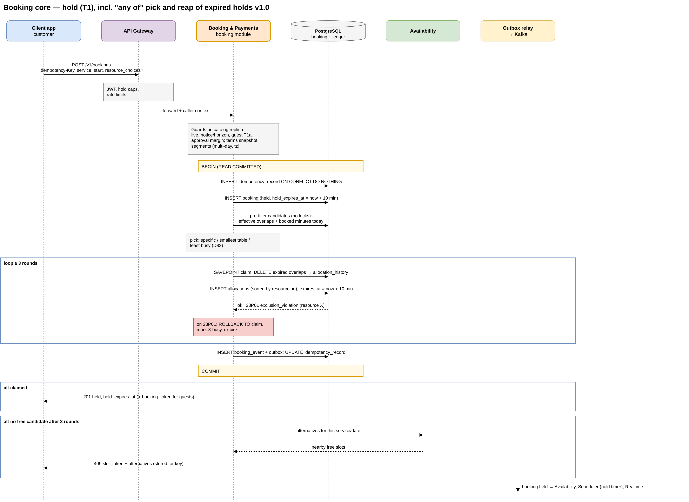
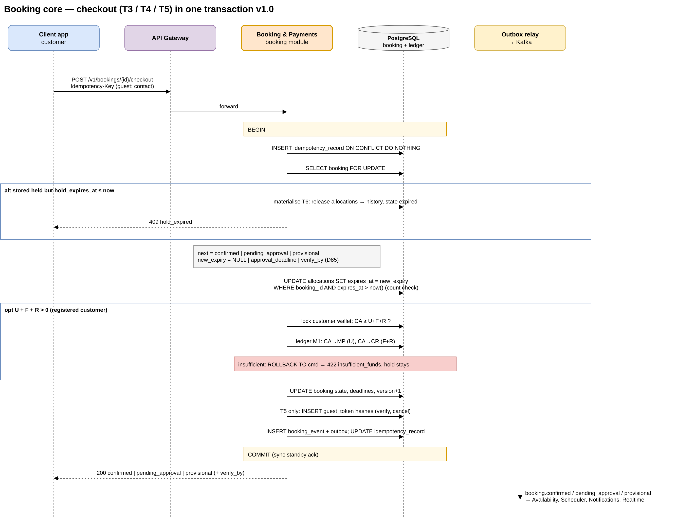
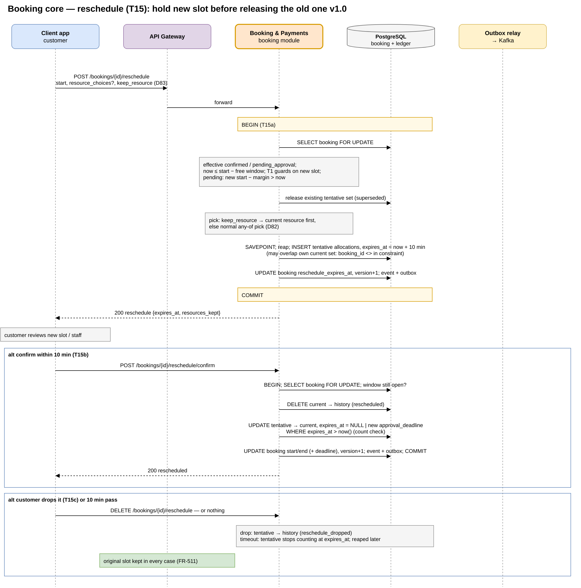
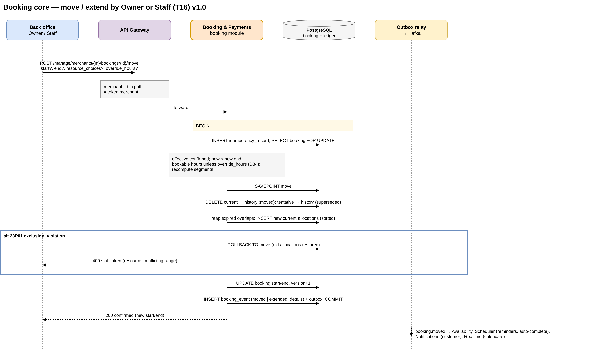

# Deep-Dive 01 — Booking Core

> Status: v1.0 (2026-11-18). Covers the booking module of **Booking & Payments**: schema, one transaction per lifecycle transition (T1–T18), allocation and overlap enforcement, "any of" selection, multi-day segments, reschedule, move/extend, idempotency, partitioning and the scale-out path. Resolves architecture Q4. Decisions D81–D89; ADR-012 (scale-out) and ADR-013 (allocation and concurrency model).
> Inputs: [booking lifecycle](../../03-domain/booking-lifecycle.md), [domain model](../../03-domain/domain-model.md), [ledger model](../../03-domain/ledger-model.md), [API conventions](../../04-api-design/api-conventions.md), [endpoint catalogue](../../04-api-design/endpoint-catalogue.md), [high-level architecture](../../05-architecture/high-level-architecture.md) §4.2, §6.1–6.3. Ledger internals (account tables, posting, hot merchant wallets) are refined in deep-dive 02; here they appear only as the "M*n*" step inside each transaction.

## 1. Context and scope

The booking module is the only place that decides whether a resource is taken. Everything else (Availability, calendars, notifications) is a read model fed by its events. This deep-dive fixes:

- how a booking and its allocations are stored, and how PostgreSQL itself makes double-booking impossible;
- the exact transaction for each transition, including locks, guards and effects;
- how effective state (NFR-107) works without waiting for jobs;
- how the data stays fast over 7 years (partitioning);
- how the service scales beyond one database primary (Q4).

Out of scope: slot computation (03), timer engine (04), outbox relay and topics (05), guest-token delivery (07), tenancy guard layers (10), ledger internals (02).

## 2. Requirements addressed

| Area | Requirements | Where |
|---|---|---|
| Booking flow | FR-501–511 | §5, §6 |
| Merchant operations | FR-601–608 | §5, §6, §7.4 |
| Multi-day, party size | FR-304, FR-305 | §4.3, §4.4 |
| Correctness | NFR-101–106, NFR-109 | §3, §6, §8 |
| Latency | NFR-302–304 | §9.2 |
| Scale and volume | NFR-401–405 | §9, §10, ADR-012 |
| Extensibility | NFR-1303, NFR-1304 | §11 |

## 3. Core design ideas

1. **Only live allocations live in the hot table.** `resource_allocation` holds allocations that still claim capacity, or may still claim it (Held, Provisional, PendingApproval, Confirmed, tentative reschedule sets). A released allocation is moved to `allocation_history` in the same transaction. The hot table stays small (a few million rows), whatever the history size (D86).
2. **The database enforces no-overlap.** A GiST exclusion constraint on `(resource_id WITH =, range WITH &&, booking_id WITH <>)` makes two overlapping allocations of different bookings on one resource impossible to commit, whatever the application does (NFR-101).
3. **`expires_at` mirrors the effective deadline.** Each allocation carries the instant at which its booking stops holding capacity: `hold_expires_at` (Held, tentative sets), `verify_by` (Provisional), `approval_deadline` (PendingApproval), or `NULL` (Confirmed). An allocation is *effective* iff `expires_at IS NULL OR expires_at > now()`. Capacity is freed the moment a deadline passes, without any job (NFR-107).
4. **Reap on conflict.** An expired allocation still occupies the constraint, so a transaction that wants the same range first deletes overlapping *expired* rows on its resources, then inserts. `expires_at` is only ever cleared or moved on rows that are still unexpired, under a row lock, so a row that has passed its expiry can never become effective again. Reaping it is always safe (§8.1).
5. **One booking row lock + version CAS per transition.** Every transition locks its booking row, evaluates effective state at the booking clock, applies state, allocations, ledger, BookingEvent, outbox and idempotency record in **one** local transaction (NFR-103, NFR-104, NFR-109).
6. **Materialise on touch.** A write that finds a booking whose stored state is behind its effective state (e.g. stored Held, hold expired) first applies the system transition (T6, T8, T10 or T17) in the same transaction, then evaluates the requested action. The Scheduler and sweep do the same for untouched bookings (ADR-010).

## 4. Data model

PostgreSQL 16+ with `btree_gist`. Enums are `text` + `CHECK` so new values need no type migration (NFR-1304). All instants are `timestamptz` (UTC); the merchant's IANA zone is stored with each booking (NFR-1001). Ids are UUIDv7 with a reserved **cell id** (§10, D81): 8 bits at the start of `rand_b`, `0` at launch.

### 4.1 Booking

```sql
CREATE TABLE booking (
  id               uuid        NOT NULL,           -- UUIDv7, time-ordered; partition key
  merchant_id      uuid        NOT NULL,           -- tenant key
  service_id       uuid        NOT NULL,
  service_version  int         NOT NULL,
  policy_version   int         NOT NULL,
  origin           text        NOT NULL CHECK (origin IN ('marketplace','booking_page','widget','merchant')),
  customer_id      uuid,                           -- registered customer
  contact          jsonb,                          -- guest / walk-in {name, email?, phone?}
  contact_email_key text,                          -- normalised, for client history (D53)
  contact_phone_key text,                          -- E.164
  created_by_kind  text        NOT NULL CHECK (created_by_kind IN ('customer','guest','merchant_user')),
  created_by_id    uuid,
  party_size       smallint,
  start_at         timestamptz NOT NULL,           -- service start (no buffers)
  end_at           timestamptz NOT NULL,           -- service end, across opening hours for multi-day
  time_zone        text        NOT NULL,           -- IANA id at booking time
  state            text        NOT NULL CHECK (state IN ('held','provisional','pending_approval','confirmed',
                                                         'completed','no_show','cancelled','rejected','expired')),
  hold_expires_at  timestamptz,                    -- held only
  verify_by        timestamptz,                    -- provisional only
  approval_requested_at timestamptz,               -- pending_approval: last request / reschedule
  approval_deadline timestamptz,                   -- pending_approval only
  reschedule_expires_at timestamptz,               -- set while a tentative set exists
  keep_resource    boolean,                        -- last reschedule preference (D83), informational
  terms            jsonb       NOT NULL,           -- BookingTerms snapshot (D88)
  version          int         NOT NULL DEFAULT 1,
  created_at       timestamptz NOT NULL DEFAULT now(),
  updated_at       timestamptz NOT NULL DEFAULT now(),
  PRIMARY KEY (id),
  CHECK ((customer_id IS NULL) <> (contact IS NULL)),
  CHECK (end_at > start_at),
  CHECK ((state = 'held')             = (hold_expires_at   IS NOT NULL)),
  CHECK ((state = 'provisional')      = (verify_by         IS NOT NULL)),
  CHECK ((state = 'pending_approval') = (approval_deadline IS NOT NULL))
) PARTITION BY RANGE (id);                         -- monthly by UUIDv7 time (§9.3)

-- per partition
CREATE INDEX ON booking (merchant_id, start_at);
CREATE INDEX ON booking (customer_id, start_at DESC) WHERE customer_id IS NOT NULL;
CREATE INDEX ON booking (merchant_id, contact_email_key) WHERE contact_email_key IS NOT NULL;
CREATE INDEX ON booking (merchant_id, contact_phone_key) WHERE contact_phone_key IS NOT NULL;
CREATE INDEX booking_open_deadlines ON booking (state, coalesce(hold_expires_at, verify_by, approval_deadline, end_at))
  WHERE state IN ('held','provisional','pending_approval','confirmed');   -- safety sweep (ADR-010)
```

### 4.2 Allocations

```sql
CREATE TABLE resource_allocation (                 -- live allocations only; unpartitioned
  id              uuid        PRIMARY KEY,
  booking_id      uuid        NOT NULL,            -- no FK: booking is partitioned; checked by reconciliation
  merchant_id     uuid        NOT NULL,
  resource_id     uuid        NOT NULL,
  requirement_id  uuid        NOT NULL,            -- which ResourceRequirement this satisfies
  segment_no      smallint    NOT NULL,            -- 0.. for multi-day (D30)
  alloc_set       text        NOT NULL CHECK (alloc_set IN ('current','tentative')),
  range           tstzrange   NOT NULL,            -- [start − buffer_before, end + buffer_after)
  service_range   tstzrange   NOT NULL,            -- without buffers, for display
  expires_at      timestamptz,                     -- effective deadline (§3.3); NULL = confirmed
  created_at      timestamptz NOT NULL DEFAULT now(),
  CHECK (NOT isempty(range) AND lower_inc(range) AND NOT upper_inc(range)),
  UNIQUE (booking_id, alloc_set, requirement_id, segment_no),
  CONSTRAINT no_double_booking EXCLUDE USING gist
    (resource_id WITH =, range WITH &&, booking_id WITH <>)
);
CREATE INDEX ON resource_allocation (booking_id);
CREATE INDEX ON resource_allocation (merchant_id, lower(range));      -- calendar
CREATE INDEX ON resource_allocation (expires_at) WHERE expires_at IS NOT NULL;  -- housekeeping

CREATE TABLE allocation_history (                  -- released allocations; immutable
  LIKE resource_allocation INCLUDING DEFAULTS,
  range_start     timestamptz NOT NULL,            -- = lower(range); partition key
  released_at     timestamptz NOT NULL,
  release_reason  text        NOT NULL CHECK (release_reason IN ('expired','abandoned','cancelled','rejected',
                     'completed','no_show','rescheduled','reschedule_dropped','moved','superseded')),
  PRIMARY KEY (id, range_start)
) PARTITION BY RANGE (range_start);                -- monthly
-- per partition
CREATE INDEX ON allocation_history (merchant_id, range_start);
CREATE INDEX ON allocation_history (resource_id, range_start);
CREATE INDEX ON allocation_history (booking_id);
```

- `booking_id WITH <>` lets a booking's **own** tentative set overlap its current set (reschedule by 30 min with the same stylist) while still excluding everyone else.
- Two requirements of one booking must not pick the same resource; the selector excludes already-chosen resources (§4.4) and a unique check on `(booking_id, alloc_set, resource_id, segment_no)` in the selector guards it.
- The calendar (FR-601) is resource-centric: live allocations ∪ history for the window, joined to bookings by id (§9.3).

### 4.3 Segments (multi-day, FR-304)

The Booking module computes segments from its catalog replica (ADR-009), using the same library as Availability (deep-dive 03):

1. Walk the resource's bookable time (opening ∩ working hours ± exceptions) in the merchant's zone from `start`, consuming `duration` minutes only while open (D30).
2. Each open period touched becomes one segment; `end_at` is the end of the last one.
3. `buffer_before` applies to the first segment only, `buffer_after` to the last.
4. Local wall-clock times are converted to UTC per segment with the IANA rules valid at booking time, so DST changes between segments are handled (NFR-1002).

Single-day services have exactly one segment. All segments of one requirement use the **same** resource (one bay holds the car for the whole job).

### 4.4 Resource selection ("any of", party size)

For each ResourceRequirement, in order: `specific` first, then `any_of` with the smallest candidate pool first (fewest choices fail fastest).

| Selector | Candidates | Order (D82) |
|---|---|---|
| `specific`, or customer picked a resource (FR-404) | The one resource | — |
| `any_of`, `fits_party_size` (tables, FR-305) | Active tables with `seating_capacity ≥ party_size` | Smallest capacity first, then least busy, then merchant order, then id |
| `any_of`, other types | Active resources of the set | **Least busy** on the merchant-local day of the slot (booked minutes from live current allocations + history with reason `completed`/`no_show`), then merchant order, then id |
| Reschedule with `keep_resource = true` (D83) | Currently allocated resource first | Then the normal order above |

Algorithm inside the transaction:

1. **Pre-filter (no locks):** one query returns, per candidate, whether it has an *effective* overlapping allocation and its booked minutes that day. Busy candidates are dropped.
2. **Pick** the first candidate per requirement, skipping resources already chosen for this booking.
3. **Claim:** `SAVEPOINT`, reap expired overlaps on the chosen resources, insert all allocations **sorted by `resource_id`, then `segment_no`** (global lock order, §6.1).
4. On `23P01 exclusion_violation` the error key names the resource: `ROLLBACK TO SAVEPOINT`, mark it busy, re-pick. At most **3 rounds**, then `409 slot_taken` with alternatives from Availability (NFR-502).

Pre-filter and claim are separate so a lost race costs one savepoint, not a whole retry from the client.

### 4.5 Booking events, guest tokens, idempotency, outbox

```sql
CREATE TABLE booking_event (                       -- append-only audit (FR-507, NFR-901)
  id           uuid        NOT NULL,               -- UUIDv7
  booking_id   uuid        NOT NULL,
  merchant_id  uuid        NOT NULL,
  kind         text        NOT NULL,               -- transition (T-number name) or same-state change
  from_state   text,
  to_state     text        NOT NULL,
  at           timestamptz NOT NULL,
  actor_kind   text        NOT NULL CHECK (actor_kind IN ('customer','guest','merchant_user','system')),
  actor_id     text,                               -- user id or job name
  reason       text,
  ledger_tx_id uuid,
  details      jsonb,                              -- e.g. old/new ranges, override_hours
  PRIMARY KEY (id)
) PARTITION BY RANGE (id);                         -- monthly
CREATE INDEX ON booking_event (booking_id, id);

CREATE TABLE guest_token (                         -- shape from domain model; delivery in deep-dive 07
  id uuid PRIMARY KEY, booking_id uuid NOT NULL, purpose text NOT NULL, channel text NOT NULL,
  secret_hash bytea NOT NULL, expires_at timestamptz NOT NULL, attempts smallint NOT NULL DEFAULT 0,
  used_at timestamptz
);

CREATE TABLE idempotency_record (                  -- NFR-106; unpartitioned, purged hourly
  caller        text        NOT NULL,              -- 'customer:<id>' | 'merchant_user:<id>' | 'guest:<booking_token id>'
  key           uuid        NOT NULL,
  request_hash  bytea       NOT NULL,              -- method + path + canonical body
  booking_id    uuid,
  status        smallint,                          -- NULL only inside the owning transaction
  response      jsonb,
  created_at    timestamptz NOT NULL DEFAULT now(),
  PRIMARY KEY (caller, key)
);
CREATE INDEX ON idempotency_record (created_at);
```

- **Idempotency row as lock:** each command transaction starts with `INSERT … ON CONFLICT (caller, key) DO NOTHING`. A concurrent duplicate waits on the unique index until the first commits, then reads the stored response. If the first rolled back, the duplicate proceeds. A different `request_hash` → `422 idempotency_key_reused`.
- Business-rule failures (`slot_taken`, `insufficient_funds`, `invalid_state` …) are stored too: the transaction rolls back to a savepoint after the idempotency insert and commits only the record. 5xx outcomes are not stored, so the client can retry safely.
- Records older than 24 h are ignored on lookup and deleted in batches every hour (≈0.5–2M rows/day: unpartitioned is fine).
- **Internal commands** from the Scheduler and sweep need no record: the CAS on state makes `expire`, `auto-cancel`, `auto-reject` and `auto-complete` idempotent (an already-applied one returns `200` with the current state).
- **Outbox:** as ADR-004; table layout, partitioning and relay are deep-dive 05. Every transaction below writes exactly one outbox row per BookingEvent.

### 4.6 Terms snapshot at hold time (D88)

The BookingTerms snapshot (price, upfront, fee, remainder, cancellation window and kept %, approval settings, cutoffs, reminder offsets, versions) is computed at **hold** (T1) and shown to the customer. Checkout charges exactly that snapshot, even if the merchant edits the service within the 10 minutes. FR-311 permits this, and the customer pays what they saw. A reschedule keeps the snapshot (D50).

## 5. Effective state and the booking clock

**Booking clock** = `now()` of the transaction (its start time). Command transactions are bounded by `statement_timeout = 2 s` and `idle_in_transaction_session_timeout = 2 s`, so a deadline is honoured at most ~2 s late and never early (NFR-1004).

| Stored state | Condition at booking clock | Effective state | Materialising transition |
|---|---|---|---|
| held | `hold_expires_at ≤ now` | expired | T6 |
| provisional | `verify_by ≤ now` | cancelled | T8 |
| pending_approval | `approval_deadline ≤ now` | rejected | T10 (M2) |
| confirmed | `end_at + 24 h ≤ now` | completed | T17 (M4) |
| any other | — | stored state | — |

- Reads (`GET`, calendar, lists) return the effective state and compute it in SQL; they never write.
- Writes **materialise on touch** (§3.6), then evaluate the requested transition against the materialised state. A customer cancelling a PendingApproval booking one second past its deadline therefore gets `409 invalid_state` with state `rejected` and a full refund already applied.
- `verify_by` for approval services is capped (D85): `verify_by = min(start − verification_cutoff, start − approval_margin)`, or, for a late guest booking, `min(start − late_booking_cutoff, start − approval_margin)`. Verification therefore always happens while the approval window is still open. If that value is ≤ now at checkout, checkout fails with `422 outside_booking_window`; Availability hides such slots for guests (FR-708).

## 6. Transactions

### 6.1 Conventions (D87)

- Isolation **READ COMMITTED** with explicit row locks. SERIALIZABLE is not needed: every conflict is either on the booking row, on allocation rows or on the exclusion constraint, and all three are serialised by locks.
- **Global lock order** (prevents deadlock cycles):
  1. `idempotency_record` (insert)
  2. `booking` row (`SELECT … FOR UPDATE`) — one booking per transaction
  3. `guest_token` row (verify / cancel by link)
  4. `resource_allocation` rows — reaps, updates and inserts in `resource_id`, `segment_no` order
  5. wallets — customer wallet, then merchant wallet (deep-dive 02 may make merchant credits lock-free)
  6. append-only inserts: ledger transaction + entries, `booking_event`, outbox; then `UPDATE idempotency_record`
- **CAS:** the booking row lock plus a check of the effective state (and the client's `If-Match` version, if sent) is the compare; `version = version + 1` is the set. The loser of a race waits on the row lock, then sees the new state → `409 invalid_state` (NFR-109).
- **Allocation release** = `DELETE … RETURNING` piped into `allocation_history` with a reason, in one statement.
- **Serialization / deadlock errors** (`40001`, `40P01`) are retried by the service up to 3 times inside the same request, with the same idempotency key. `deadlock_timeout` is lowered to 200 ms on this cluster.
- Tenant scoping: every statement also filters on `merchant_id` (or `customer_id` for `/me`), per deep-dive 10. It is omitted below for brevity.

### 6.2 Hold (T1) and staff booking (T2)

```sql
BEGIN;
INSERT INTO idempotency_record (caller, key, request_hash) VALUES ($caller, $key, $hash)
  ON CONFLICT (caller, key) DO NOTHING;          -- 0 rows → return stored response
SAVEPOINT cmd;
-- guards from the local catalog replica (§6.4 table): merchant live, service active, notice/horizon,
-- guest rules T1a, approval margin; compute terms snapshot and segments (§4.3)
INSERT INTO booking (id, …, state, hold_expires_at, terms, version)
  VALUES ($id, …, 'held', now() + interval '10 minutes', $terms, 1);
-- §4.4 pre-filter + pick, then:
SAVEPOINT claim;
WITH reaped AS (
  DELETE FROM resource_allocation
   WHERE resource_id = ANY($picked) AND range && ANY($ranges) AND expires_at <= now()
  RETURNING *)
INSERT INTO allocation_history SELECT reaped.*, lower(range), now(), 'expired' FROM reaped;
INSERT INTO resource_allocation (…, alloc_set, range, expires_at)
  SELECT … , 'current', r.range, now() + interval '10 minutes'
  FROM unnest($rows) r ORDER BY r.resource_id, r.segment_no;
-- 23P01 → ROLLBACK TO SAVEPOINT claim; re-pick (≤3 rounds) or ROLLBACK TO SAVEPOINT cmd + slot_taken
INSERT INTO booking_event (…'held'…);  INSERT INTO outbox (…'booking.held'…);
UPDATE idempotency_record SET status = 201, response = $resp, booking_id = $id WHERE caller = $caller AND key = $key;
COMMIT;
```

**T2** (Owner/Staff creates booking) is the same transaction with: state `confirmed`, `hold_expires_at` NULL, allocations with `expires_at` NULL, zero-payment terms, `customer_id` or walk-in `contact`. Staff rules (D84):

- the range must lie within the resources' bookable time (opening ∩ working hours ± exceptions), unless the request sets `override_hours = true`, which is recorded in the BookingEvent `details`;
- `min_notice` does **not** apply (walk-ins start now); `max_horizon` applies;
- the merchant may be `live` or `paused` (FR-104 pauses public discovery only); `setup` is rejected (`422 merchant_not_ready`).

### 6.3 Checkout (T3, T4, T5)

```sql
BEGIN;
INSERT INTO idempotency_record … ON CONFLICT DO NOTHING;
SAVEPOINT cmd;
SELECT * FROM booking WHERE id = $id FOR UPDATE;
-- caller owns it (customer_id = caller, or guest booking token); If-Match = version if sent
-- stored 'held' but hold_expires_at <= now → materialise T6 (§6.5), COMMIT with 409 hold_expired
-- next = provisional (guest, verification on) | pending_approval (terms.requires_approval) | confirmed
-- new_expiry = verify_by (capped, §5) | approval_deadline = min(now + window, start − margin) | NULL
UPDATE resource_allocation SET expires_at = $new_expiry
 WHERE booking_id = $id AND alloc_set = 'current' AND expires_at > now();
-- row count ≠ booking's allocation count → hold_expired (a reaper got there first)
-- ledger M1 if U+F+R > 0 (deep-dive 02): lock customer wallet, CA ≥ U+F+R else
--   ROLLBACK TO SAVEPOINT cmd → 422 insufficient_funds, booking stays held (FR-504)
UPDATE booking SET state = $next, hold_expires_at = NULL, verify_by = …, approval_requested_at = …,
       approval_deadline = …, contact = …, version = version + 1, updated_at = now() WHERE id = $id;
-- T5: INSERT guest_token rows (verify by email link + SMS code, cancel link; hashes only)
INSERT INTO booking_event …; INSERT INTO outbox …;           -- routing: owner + assigned staff user ids
UPDATE idempotency_record SET status = 200, response = $resp …;
COMMIT;
```

A guest with verification **off** goes `held → confirmed` (T3) with no ledger step: guests never have payment terms (FR-701).

### 6.4 Transition table (T1–T18)

All rows follow §6.1: idempotency → booking lock → effective-state check → allocations → ledger → event + outbox → idempotency response. "Release" = move all live allocations of the booking (current and tentative) to history with the given reason. "Clear" = `UPDATE … SET expires_at = <x> WHERE … AND expires_at > now()` with a row-count check.

| # | Transition | Effective state required | Extra guards | Allocation step | Ledger | Booking update | Event |
|---|---|---|---|---|---|---|---|
| T1 | ∅ → held | — | Merchant live; service active; `start − now ≥ min_notice`; `start ≤ now + max_horizon`; guest rules T1a; approval: `start − margin > now` | Reap + insert current, `expires_at = now + 10 min` (§4.4) | — | Insert, terms snapshot | held |
| T2 | ∅ → confirmed | — | D84 (hours unless override, horizon, not `setup`) | Reap + insert current, `expires_at` NULL | — | Insert, zero-payment terms | created_by_merchant |
| T3 | held → confirmed | held | Caller owns hold | Clear to NULL | M1 (if U+F+R > 0) | state, clear hold | confirmed |
| T4 | held → pending_approval | held | Computed deadline > now | Clear to `approval_deadline` | M1 | state, deadline, requested_at | pending_approval |
| T5 | held → provisional | held | Guest; capped `verify_by` > now | Clear to `verify_by` | — | state, verify_by, contact; guest tokens | provisional |
| T6 | held → expired | held, or stored held + expired | Customer/guest abandon, or system | Release (`abandoned` / `expired`); already-reaped rows are fine | — | state, clear hold | expired |
| T7 | provisional → confirmed / pending_approval | provisional | Valid token/code (row-locked; failed attempt commits `attempts + 1`) or Staff | Clear to NULL, or to `approval_deadline` | — | state; deadline `min(now + window, start − margin)` (> now by D85) | verified |
| T8 | provisional → cancelled | provisional, or stored provisional + past `verify_by` | System, guest cancel token, Staff | Release (`cancelled`) | — | state; tokens `used_at` | cancelled |
| T9 | pending_approval → confirmed | pending_approval | Owner, or Staff linked to an allocated staff resource (replica) | Clear to NULL | — | state, clear deadline | approved |
| T10 | pending_approval → rejected | pending_approval, or stored + past deadline | Owner / assigned Staff, or system | Release (`rejected`) | M2 | state | rejected |
| T11 | pending_approval → cancelled | pending_approval | `now < start` | Release (`cancelled`) | M2 | state | cancelled |
| T12 | confirmed → cancelled (in window) | confirmed | Customer/guest; `now ≤ start − free_window` | Release (`cancelled`) | M2 | state | cancelled |
| T13 | confirmed → cancelled (late) | confirmed | Customer/guest; `start − free_window < now < start` | Release (`cancelled`) | M3 | state | cancelled_late |
| T14 | confirmed → cancelled (merchant) | confirmed | Owner/Staff; `now < end` | Release (`cancelled`) | M2 | state | cancelled_by_merchant |
| T15a | reschedule: hold new slot | confirmed / pending_approval | Customer; `now ≤ start − free_window`; same service; T1 guards on new slot; pending: `new start − margin > now` | Release existing tentative (`superseded`); reap + insert tentative, `expires_at = now + 10 min` (§4.4, D83) | — | `reschedule_expires_at`, `keep_resource`, version + 1 | reschedule_held |
| T15b | reschedule: confirm | as T15a | Tentative exists and unexpired; window still open | Release current (`rescheduled`); tentative → current, `expires_at` = NULL or new deadline | — | start/end; pending: new `approval_deadline`, `approval_requested_at = now` | rescheduled |
| T15c | reschedule: drop | as T15a | Tentative exists | Release tentative (`reschedule_dropped`) | — | clear `reschedule_expires_at` | reschedule_dropped |
| T16 | confirmed → confirmed (move / extend) | confirmed | Owner/Staff; D84 hours rule; `now < new end` | Savepoint: release current (`moved`) and any tentative (`superseded`); reap + insert new current (same resources unless `resource_choices`) | — | start/end, version + 1 | moved / extended |
| T17 | confirmed → completed | confirmed, or stored + past end + 24 h | Owner/Staff after start; system | Release (`completed`) | M4 | state | completed |
| T18 | confirmed → no_show | confirmed | Owner/Staff; `start ≤ now < end + 24 h` | Release (`no_show`) | M5 | state | no_show |

Notes:

- **System commands** (T6, T8, T10, T17 from the Scheduler or sweep) take the same transaction with actor `system:<job>`. If the booking is no longer in the expected stored state, they no-op and return the current state.
- **T7 by code:** the guest token row is locked after the booking row (lock order). Failed attempts must persist, so a wrong code commits `attempts + 1` and the idempotency record with `422 invalid_code`; after the limit the token is burned (deep-dive 07).
- **T15 with a tentative set expired:** confirm finds 0 unexpired tentative rows → `409 hold_expired`; the original slot is untouched (FR-511). Stale tentative rows are reaped on conflict or by hourly housekeeping (no event needed: Availability treats `expires_at` the same way, deep-dive 03).
- **T16 extend** recomputes segments from the original start; **move** recomputes from the new start. If the new range is not free, the savepoint restores the old allocations and the call fails `409 slot_taken`.
- **T17/T18 marked early** release the remaining time at once (lifecycle §3), so a walk-in can take it.

### 6.5 Reschedule (T15) in SQL

```sql
-- T15a: hold the new slot (customer)
SELECT * FROM booking WHERE id = $id FOR UPDATE;          -- effective confirmed / pending_approval
-- guards; pick per §4.4 with keep_resource preference (D83)
WITH gone AS (DELETE FROM resource_allocation WHERE booking_id = $id AND alloc_set = 'tentative' RETURNING *)
INSERT INTO allocation_history SELECT gone.*, lower(range), now(), 'superseded' FROM gone;
SAVEPOINT claim;  -- reap + INSERT tentative rows, expires_at = now() + interval '10 minutes'
UPDATE booking SET reschedule_expires_at = now() + interval '10 minutes', keep_resource = $keep,
       version = version + 1 WHERE id = $id;
-- response includes reschedule.expires_at and resources_kept (true/false) so the customer
-- sees a changed stylist/bay before confirming

-- T15b: confirm
SELECT * FROM booking WHERE id = $id FOR UPDATE;
WITH old AS (DELETE FROM resource_allocation WHERE booking_id = $id AND alloc_set = 'current' RETURNING *)
INSERT INTO allocation_history SELECT old.*, lower(range), now(), 'rescheduled' FROM old;
UPDATE resource_allocation SET alloc_set = 'current', expires_at = $new_expiry   -- NULL | new deadline
 WHERE booking_id = $id AND alloc_set = 'tentative' AND expires_at > now();      -- count check → else hold_expired
UPDATE booking SET start_at = $s, end_at = $e, reschedule_expires_at = NULL,
       approval_deadline = …, approval_requested_at = …, version = version + 1 WHERE id = $id;
```

Within one transaction, the delete of the current set and the promotion of the tentative set happen together, so a reader sees either the old slot or the new one, never neither or both (FR-511).

## 7. Sequence diagrams

### 7.1 Hold



*Source: [diagrams/01-booking-core-hold.drawio](diagrams/01-booking-core-hold.drawio)*

### 7.2 Checkout



*Source: [diagrams/02-booking-core-checkout.drawio](diagrams/02-booking-core-checkout.drawio)*

### 7.3 Reschedule



*Source: [diagrams/03-booking-core-reschedule.drawio](diagrams/03-booking-core-reschedule.drawio)*

### 7.4 Move / extend



*Source: [diagrams/04-booking-core-move.drawio](diagrams/04-booking-core-move.drawio)*

## 8. Concurrency analysis

### 8.1 No double-booking (NFR-101)

**Claim.** For every resource and every instant, at most one booking holds an effective allocation covering it.

1. Every allocation that could be effective is a row in `resource_allocation`: allocations are only created there, and only leave it by being moved to history (release or reap).
2. The exclusion constraint forbids two rows of different bookings with the same `resource_id` and overlapping `range`, at commit time, whatever the isolation level or application logic. Effective rows are a subset of all rows, so no two effective rows of different bookings overlap. ∎
3. Expired rows can only cause *false* conflicts, never a double-booking. Reaping removes them, and it is safe because of the **monotonic expiry rule**: `expires_at` is changed only by an `UPDATE … WHERE expires_at > now()` under a row lock (T3–T5, T7, T9, T15b). A row past its expiry therefore never becomes effective again.
4. Reaper vs reviver race (e.g. a new hold reaping while the owner checks out at the last second): both touch the same row, so the row lock orders them. If checkout commits first, the reaper re-evaluates `expires_at <= now()` after the lock wait (READ COMMITTED re-check), sees NULL, skips the row, and its insert hits the constraint → `slot_taken`. If the reaper commits first, the checkout's `UPDATE` matches 0 rows → `hold_expired`. No outcome has both.
5. Buffers and multi-day spans are inside `range` and per-segment rows, so they are covered by the same constraint (NFR-101 wording).
6. Reconciliation (NFR-110) re-checks the invariant nightly on the async replica: overlaps among live rows (should be impossible), history ranges vs terminal bookings, and allocations without a non-terminal booking.

### 8.2 One winner per booking (NFR-109)

All transitions of one booking serialise on its row lock; the effective-state check after the lock decides.

| Race | Winner | Loser sees |
|---|---|---|
| Customer cancels vs Staff marks no-show | First to lock | `409 invalid_state` (cancelled / no_show) |
| Approve vs approval deadline | Approve if its booking clock < deadline; else materialised auto-reject | `409 invalid_state` (`rejected`, refund done) |
| Checkout vs hold expiry job | Checkout if clock < `hold_expires_at` | Job no-ops (already confirmed) |
| Checkout vs a new hold reaping the expired rows | See §8.1 (4) | `hold_expired` or `slot_taken` |
| Checkout vs abandon (two tabs) | First to lock | `409 invalid_state` |
| Two holds on the same slot | First to commit its insert (the second waits on the constraint) | `409 slot_taken` + alternatives |
| Hold vs another booking's tentative reschedule set | Same as two holds | `409 slot_taken` |
| Reschedule confirm vs Staff move | First to lock; move also drops the tentative set | `409 invalid_state` / `hold_expired` |
| Reschedule confirm vs tentative expiry | Confirm if tentative `expires_at > now` | `409 hold_expired`, old slot kept |
| Guest verify vs verification cutoff | Verify if clock < `verify_by` | Materialised T8, `409 invalid_state` |
| Customer cancel vs merchant cancel | First to lock | `409 invalid_state` |
| No-show vs auto-complete | No-show if clock < end + 24 h | Job no-ops / `409` |
| Same command retried (network) | Original | Stored idempotent response |

### 8.3 Deadlocks

- Within a booking, all locks follow §6.1.
- Across bookings, transactions only contend on allocation rows and constraint checks, and every transaction claims allocations in `resource_id` order, so waits form no cycles.
- Wallet locks come after allocations and in a fixed order. A hold never locks a wallet, and a checkout never inserts allocations.
- Remaining risk (bugs, unforeseen orders) is covered by the 200 ms `deadlock_timeout` plus automatic in-request retry.

### 8.4 Idempotency (NFR-106)

See §4.5. A retried hold returns the same booking id; a retried checkout returns the original outcome, including `insufficient_funds`. Ledger transactions also carry a unique key `booking_id + operation` (ledger model §7) as a second guard.

## 9. Scaling and performance

### 9.1 Load at 3× peak (NFR-402)

| Item | Estimate |
|---|---|
| Holds + checkouts | ~1,000/s each, worst case (treat as 2,000 command tx/s) |
| Later transitions (expire, complete, cancel, approve …) | ~1 per hold on average → ~1,000 tx/s |
| Row writes per command tx | 6–10 (idempotency, booking, 1–3 allocations, history, event, outbox, ledger 2–6 entries) |
| Total | ~3,000 tx/s, ~25k row writes/s, ~20–40 MB/s WAL |
| Live allocation table | ~3–6M rows (≈100k bookings/day × ~30-day horizon × 1.5) |

A single PostgreSQL primary (e.g. 32 vCPU, 128–256 GB RAM, NVMe-class storage) with a synchronous standby comfortably sustains 10–15k short write tx/s. That is **3–5× headroom** over this load. Connections go through PgBouncer in transaction mode (≈100–200 server connections).

### 9.2 Latency budget (NFR-302–304)

| Step | Hold (≤300 ms) | Checkout (≤500 ms) |
|---|---|---|
| Gateway (auth, limits) | 10 ms | 10 ms |
| Service logic, replica reads, segment/slot math | 20 ms | 10 ms |
| DB statements | 10–20 ms | 10–25 ms |
| Commit with sync standby (cross-AZ) | 2–5 ms | 2–5 ms |
| Network and serialisation | 20 ms | 20 ms |
| **p95 target inside service** | **≤ 100 ms** | **≤ 150 ms** |

The rest of each budget is margin for lock waits on hot resources, retries (§4.4) and GC. Load tests (deep-dive 14) validate these numbers.

### 9.3 Partitioning and retention (NFR-405, D89)

| Table | Partitioning | Retention | Why |
|---|---|---|---|
| `booking` | Monthly by UUIDv7 id range | 7 years (older partitions detached to cheaper storage, still queryable) | Lookup by id prunes to one partition; partitions are created 3 months ahead by a maintenance job |
| `booking_event` | Monthly by UUIDv7 id | 7 years | Append-only audit |
| `resource_allocation` | None (live rows only) | Until release | Exclusion constraints need one table; stays small |
| `allocation_history` | Monthly by `range_start` | 7 years | Immutable once written, so no row movement; calendar and history queries prune by date |
| `idempotency_record` | None | 24 h, hourly batch delete | Small; unique key must span all rows |
| `guest_token` | None | Purged 30 days after booking end | Small |
| Outbox, ledger | Deep-dives 05, 02 | — | — |

Query paths:

- **Calendar (FR-601):** `resource_allocation` (live) ∪ `allocation_history` partitions covering the window, filtered by `merchant_id` / `resource_id`, then booking rows by primary key.
- **`/me/bookings` (FR-508):** `customer_id` index on each booking partition, newest first with cursor pagination. That is one index probe per partition (≤ 84). This is cheap at this query rate, and it can move to the async read replica.
- **Client history (FR-607):** contact-key / `customer_id` indexes per partition, within the merchant.
- **Sweep:** `booking_open_deadlines` partial index; only non-terminal rows are in it.
- Read-only queries (calendar, lists, history, reconciliation, Availability backfills) may use the async replica when ≤2 s staleness is acceptable. Command transactions always use the primary.

### 9.4 Hot tenants (NFR-404)

- **Exclusion conflicts** only touch the merchant's own resources and overlapping ranges. A restaurant releasing a month of tables contends with itself, not with other tenants.
- **Hold floods** are capped at the gateway (per customer / IP / merchant, deep-dive 11). The selector's bounded retries (≤3 rounds) cap DB work per request.
- **Merchant wallet** is the one per-merchant hot row: every paid checkout credits its Pending account. A single locked balance row limits one merchant to a few hundred paid checkouts/s. Deep-dive 02 removes the lock for credits (credits can't overdraft; for example bucketed balance rows or entry-derived balances). That is a hand-off, not an open question.

## 10. Scale-out path (Q4 → ADR-012, D81)

**Decision:** launch on **one primary**, shard-ready; scale out to **merchant cells** when triggers fire.

### 10.1 Shard-ready now

- Every booking-side row carries `merchant_id`; no query joins bookings of different merchants (except customer lists, which fan out by design).
- Booking ids and wallet ids reserve 8 bits for a **cell id** (0 today), so any id can be routed without a lookup.
- The merchant wallet and its ledger entries are always written together with the merchant's bookings, so they can move together. Customer wallets are only touched in checkout (debit), top-up/withdraw and credits from M2–M5.
- The service accesses the DB through a `CellRouter` (today: always cell 0).

### 10.2 Triggers (any one, sustained over a week of peaks)

- Primary CPU > 60%, or WAL/sync-commit latency p95 > 10 ms;
- checkout DB time p95 > 100 ms;
- projected load (growth trend) > 50% of the measured primary limit within 6 months.

Before cells: (1) move read paths to async replicas, (2) scale the primary vertically, (3) tune partitioning/vacuum.

### 10.3 Target shape

| Cell type | Key | Holds |
|---|---|---|
| **Merchant cell** (N) | `merchant_id` → cell via a directory (cached; also encoded in ids) | Bookings, allocations, events, merchant wallets + their ledger accounts, outbox |
| **Wallet cell** (M) | `hash(customer_id)` | Customer wallets + their ledger accounts, authorizations, outbox |

Per-merchant flows (holds, staff actions, calendar, allocations) stay single-cell, fully ACID. Only flows that touch a customer wallet cross cells:

- **Checkout (debit) — synchronous two-step:**
  1. *Wallet cell:* lock wallet, check CA ≥ U+F+R, post `CA −U → inter-cell clearing +U` and `CA −(F+R) → CR +(F+R)`, record an **authorization** (`booking_id`, amounts, `authorized`).
  2. *Merchant cell:* the checkout transaction of §6.3, with `MP +U ← inter-cell clearing` instead of a local debit, recording the authorization id.
  3. If step 2 fails (expired, taken), the service **voids** the authorization (compensating entries). A recovery job resolves authorizations left `authorized` for > 30 s by asking the merchant cell for the booking outcome (capture or void).
- **Credits (M2–M5 refunds, releases):** the merchant cell commits state + its own entries + an outbox "transfer" message; the wallet cell applies it idempotently. Credits to a customer can't fail, so async delivery is safe. Moving reserved F+R out of CR works the same way, because CR is reserved per booking.
- **Invariants:** the ledger invariants hold per cell, plus a new cross-cell one: Σ inter-cell clearing across cells = transfers in flight, and every in-flight transfer settles within minutes (reconciliation alert).

**Trade-off accepted:** in cells, a customer may briefly (milliseconds; seconds in a failure) see an authorized amount leave Available before the booking shows as confirmed. Authorizations are shown as "pending checkout" in the wallet, and the booking is never confirmed without funds, so NFR-103's intent (no partial outcome persists) holds. The project accepts this only when the triggers fire.

**Moving a merchant between cells:** copy its rows, briefly block writes for that merchant (seconds), copy the delta, flip the directory, unblock. Ids keep their original cell bits, so the directory overrides them for moved merchants.

Alternatives (ADR-012): sharding from day one; distributed SQL (CockroachDB/YugabyteDB: no GiST exclusion constraints, more operational novelty); one global wallet database (moves the cross-shard problem without removing it).

## 11. Extensibility (NFR-1303, NFR-1304)

| Future feature | How the core absorbs it |
|---|---|
| New verticals / resource types | Resource types and requirements are data; the selector is type-agnostic apart from the `fits_party_size` flag |
| Chained services (e.g. wash then cut, different staff) | A requirement gets an offset/duration within the booking; allocations are already per requirement and per segment |
| Table combining | One requirement satisfied by a *set* of resources: several allocations share a `requirement_id`; constraint unchanged |
| Physical stock / counted capacity | The exclusion constraint models exclusive resources only. Counted capacity gets a second allocation strategy (capacity rows per resource and time bucket with a `CHECK (used ≤ capacity)`), behind the same `Allocator` interface used by T1/T2/T15/T16 |
| Chains / branches | Merchant stays the tenant and allocation key; an organisation id is added above it. Cells could later key on organisation |
| Waitlists, recurring, group bookings | New aggregates that create ordinary bookings through T1/T2; no change to allocation rules |
| Platform fee, real payments | Ledger only (deep-dive 02) |

## 12. Failure modes and edge cases

| Case | Behaviour |
|---|---|
| Scheduler down | Effective state keeps capacity and actions correct; materialisation happens on touch or when it recovers; the sweep catches lost timers (ADR-010) |
| DB failover mid-transaction | Transaction lost and rolled back; client retries with the same Idempotency-Key → executes once |
| Client retries after timeout but the first attempt committed | Stored response returned |
| Catalog replica slightly stale (service edited during hold) | Booking uses the snapshot taken at hold (D88, FR-311) |
| Resource deactivated or time-off added over existing bookings | Existing allocations stay; Catalog event → Booking flags affected bookings to the merchant (calendar badge); no auto-cancel in MVP |
| DST gap/overlap inside a booking | Segment conversion uses IANA rules per segment (§4.3); slot generation avoids non-existent times (deep-dive 03) |
| tz database update changes a future offset | Bookings keep local wall-clock time (NFR-1003): a maintenance job recomputes UTC ranges of affected future allocations in a transaction that is itself checked by the exclusion constraint; conflicts are reported to the merchant |
| Customer has an expired hold and checks out | `409 hold_expired`; T6 materialised in the same transaction |
| Insufficient funds | `422 insufficient_funds`; hold kept until expiry (FR-504); the customer tops up and retries with a new key |
| Same customer holds many slots | Gateway caps (NFR-707) |

## 13. Alternatives considered

| Alternative | Why not |
|---|---|
| Discrete slot rows + unique constraint | Doesn't fit arbitrary durations, buffers and multi-day segments; row count explodes for fine granularity |
| Advisory lock per resource + `SELECT` overlap check | Correct only if every writer remembers to lock; serialises non-overlapping holds on the same resource; the exclusion constraint is enforced by the database itself |
| Keep released allocations in the hot table with `active = false` and a partial constraint | Table and GiST index grow without bound (≈375M rows over 7 years); history split keeps the hot path small |
| SERIALIZABLE isolation | Adds retry storms under contention without making the design simpler; all conflicts are already lock- or constraint-serialised |
| Redis locks for holds | Second source of truth; failover can lose locks (NFR-101 risk) |
| Terms snapshot at checkout | Customer could pay a different price than shown; FR-311 allows the hold-time snapshot |

## 14. Decisions

| ID | Decision | Date | ADR |
|---|---|---|---|
| D81 | Booking & Payments launches on a single PostgreSQL primary (sync standby), shard-ready (merchant id everywhere, cell id bits in ids, `CellRouter`). Scale-out path = merchant cells (bookings + merchant wallets) and customer-keyed wallet cells with a two-step authorization for checkout and async credits; triggered by measured thresholds | 2026-11-18 | ADR-012 |
| D82 | "Any available" assignment picks the free candidate that is least busy (booked minutes) on the merchant-local day; ties by merchant order, then id. Tables: smallest fitting capacity first | 2026-11-18 | — |
| D83 | When rescheduling an "any available" booking, the customer chooses: keep the current resource if it's free (`keep_resource = true`, else fall back to the normal pick, reported as `resources_kept`), or a normal any-of pick. A specific choice stays specific | 2026-11-18 | — |
| D84 | Staff-created bookings (T2) and moves (T16) must lie within bookable hours unless `override_hours = true` (logged); `min_notice` doesn't apply; `max_horizon` applies; allowed while the merchant is live or paused | 2026-11-18 | — |
| D85 | For approval services, a guest's `verify_by` is capped at `start − approval_margin`, so verification always ends before the approval window closes | 2026-11-18 | — |
| D86 | Allocation model: live allocations only in `resource_allocation` with GiST exclusion `(resource_id =, range &&, booking_id <>)`; `expires_at` mirrors the booking's effective deadline; reap expired overlaps on conflict; released rows moved to partitioned `allocation_history` | 2026-11-18 | ADR-013 |
| D87 | Transaction conventions: READ COMMITTED + booking row lock + version CAS; global lock order (idempotency → booking → guest token → allocations by resource id → wallets → inserts); booking clock = transaction `now()` with 2 s timeouts; materialise on touch; idempotency row as lock; in-request retry on 40001/40P01 | 2026-11-18 | ADR-013 |
| D88 | BookingTerms are snapshotted at hold time and charged unchanged at checkout | 2026-11-18 | — |
| D89 | Partitioning: bookings and booking events monthly by UUIDv7 id; allocation history monthly by range start; idempotency records unpartitioned with 24 h purge | 2026-11-18 | — |

## 15. Open questions

| # | Question | Status | Raised |
|---|---|---|---|
| Q1 | Scale-out path beyond one primary (architecture Q4) | Resolved → D81, ADR-012 | 2026-11-15 |
| Q2 | "Any available" assignment rule | Resolved → D82 | 2026-11-18 |
| Q3 | Reschedule of "any available" bookings | Resolved → D83 | 2026-11-18 |
| Q4 | Rules for staff-created bookings | Resolved → D84 | 2026-11-18 |
| Q5 | Guest verification after the approval margin | Resolved → D85 | 2026-11-18 |

Hand-offs (not open, owned elsewhere): merchant-wallet credit contention → 02; slot library shared with §4.3 and `expires_at` in Availability's replica → 03; timer commands and sweep cadence → 04; outbox table and relay → 05; guest token delivery → 07; tenant guards and RLS → 10; hold caps → 11; load tests for §9 → 14.

## 16. Change log

| Version | Date | Change |
|---|---|---|
| v1.0 | 2026-11-18 | First version: schema, T1–T18 transactions, concurrency analysis, partitioning, scale-out (D81–D89, ADR-012, ADR-013) |
