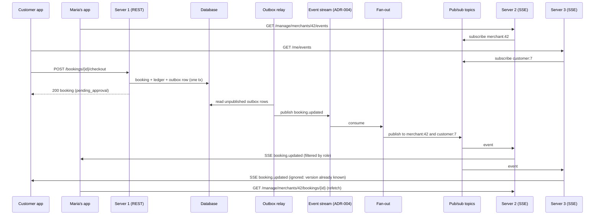

# ADR-005: SSE fan-out across multiple servers — per-user pub/sub topics

- **Status:** Accepted (fan-out: Redis Pub/Sub + Streams, see [ADR-008](ADR-008-messaging.md))
- **Date:** 2026-11-12
- **Decision:** D69

## 1. Context

SSE is our live-update channel (ADR-001). The API runs on many servers behind a load balancer; a client's SSE connection lives on one arbitrary server, and the change it must hear about is made by a REST request (or scheduled job) on any other server. A server can only write to connections it holds itself. We must deliver within ≤ 2 s (NFR-503) without requiring sticky routing.

## 2. Options

| Option | Pros | Cons |
|---|---|---|
| **Per-user pub/sub topics**: each SSE server subscribes to topics of the users connected to it | Servers only receive events they need; no registry; any server can hold any connection | Many small, short-lived topics; needs a broker good at that |
| Broadcast every event to all servers, each filters | Simplest | Every server processes every event; wasteful as servers and events grow |
| Connection registry (user → server) + direct routing | Precise | Registry must stay in sync with connects/disconnects/crashes; most moving parts |
| Sticky sessions / same-server pinning | No broker | Impossible to pin customer and merchant together; breaks on failover |

## 3. Decision

1. **Topics per recipient:** `customer:{customer_id}` and `merchant:{merchant_id}`.
2. When a client opens an SSE stream, the server holding it **subscribes** to that client's topic (first connection) and **unsubscribes** when its last connection for that topic closes.
3. A **fan-out step** consumes the durable event stream (ADR-004) and republishes each event to the recipient topics in its `routing` (customer and merchant).
4. The SSE server applies **authorisation filtering** before writing to a connection: Staff only receive events for bookings assigned to or created by them (FR-204); Owners receive all events of their merchant.
5. Clients receive the **thin** event and refetch over REST (API conventions §9). Loss on the fan-out path is acceptable — REST stays the source of truth.
6. **Replay on reconnect:** each event carries its stream `id`. A reconnecting client sends `Last-Event-ID` to whichever server it lands on; that server reads missed events for the client's topic from a **shared** replay store (≥ 5 min retention), not from local memory. If the gap is older than retention, the server tells the client to reload (`event: reset`).
7. SSE servers MAY be run as a separate **gateway tier** that scales independently of the REST API.

## 4. Flow

## 5. Consequences

- Customer and merchant never need to share a server; no sticky sessions; failover is a plain reconnect.
- Two broker roles: a **durable stream** (ADR-004) and a **lightweight pub/sub** for fan-out. One technology may serve both if it handles many small topics well.
- Notification service and read models consume the durable stream directly; they don't depend on the fan-out path.
- Metrics to watch: open connections per server, subscribe/unsubscribe rate, fan-out lag, replay misses.

## 6. Open questions

| # | Question | Status | Raised |
|---|---|---|---|
| Q1 | Pub/sub and replay-store technology (e.g. Redis Pub/Sub + Redis Streams, NATS + JetStream), and whether it is the same as ADR-004's broker | Resolved → D72 (Redis Pub/Sub + Streams; Kafka for the durable stream, ADR-008) | 2026-11-12 |
